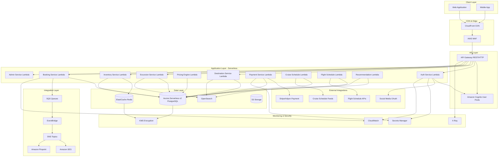
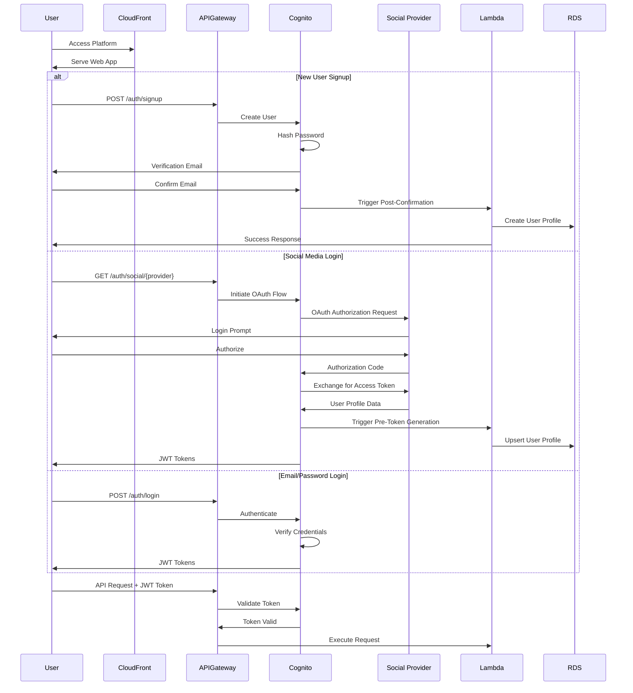
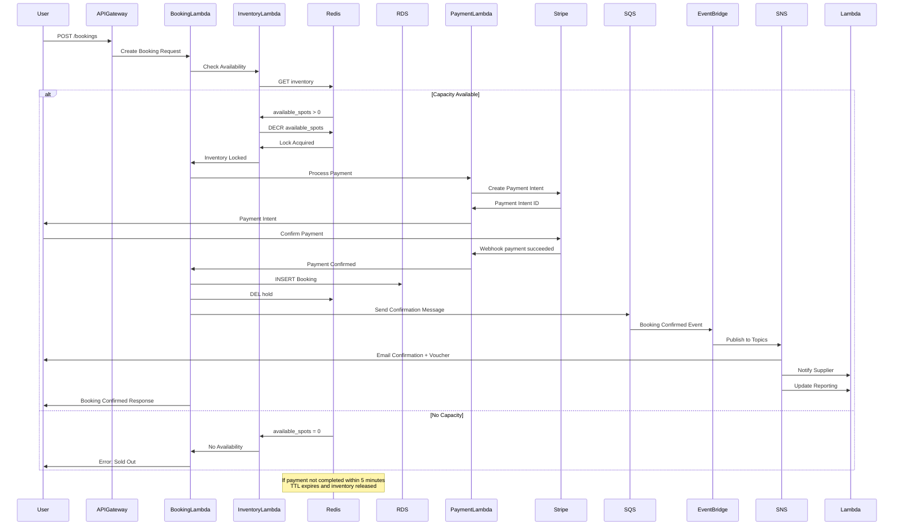
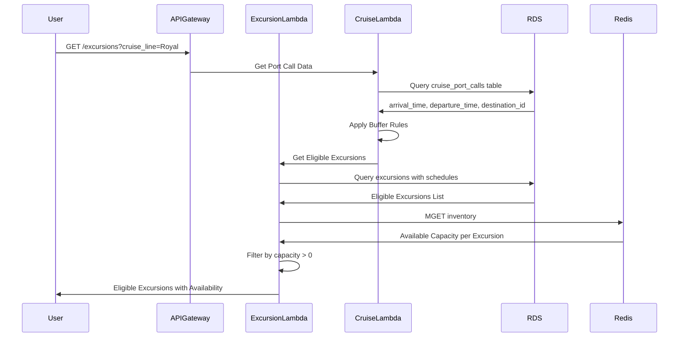
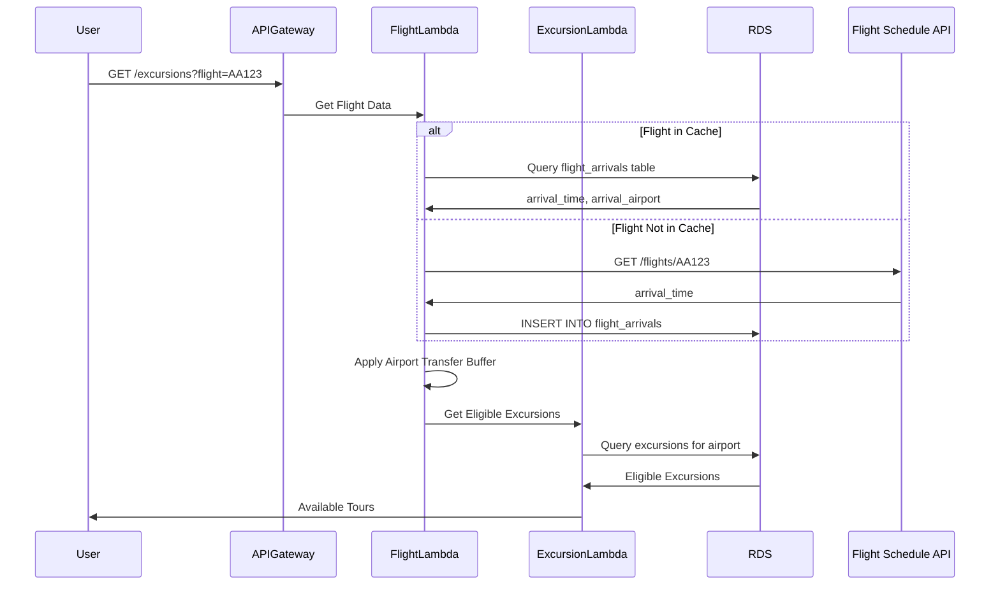

# Design Document: Tour Excursion Booking Platform

## Overview

The Tour Excursion Booking Platform is a comprehensive AWS-based system that enables travelers to discover, book, and manage shore excursions and tours based on their destination, cruise itinerary, or flight arrival. The platform supports destination-based selling with intelligent time-window filtering for cruise passengers and flight arrivals, dynamic pricing, real-time inventory management, and multi-channel authentication including social media login. The system integrates with cruise schedule feeds, flight APIs, and payment gateways to provide a seamless booking experience while ensuring operational safeguards like timezone-aware logic, booking cut-offs, and overbooking prevention.

The architecture leverages AWS managed services for scalability, reliability, and cost-effectiveness, including API Gateway for API management, Lambda with Go runtime for serverless compute, Aurora Serverless v2 PostgreSQL for all persistent data with auto-scaling capabilities, ElastiCache Redis for inventory locking, Cognito for authentication, EventBridge for event-driven workflows, and SageMaker for AI-powered recommendations. The frontend is built with React and TypeScript, while infrastructure is managed using AWS CDK with TypeScript.

## Technology Stack

**Backend (Lambda Functions)**:
- Language: Go (Golang) 1.21+
- Runtime: AWS Lambda Go 1.x
- All backend services and Lambda functions are written in Go

**Frontend**:
- Framework: React
- Language: TypeScript
- Build tool: Vite or Create React App

**Infrastructure as Code**:
- Tool: AWS CDK
- Language: TypeScript
- This is standard practice for AWS CDK and remains in TypeScript

**Database & Storage**:
- Primary Database: Aurora Serverless v2 PostgreSQL
- Cache: ElastiCache Redis
- Object Storage: Amazon S3
- Search: Amazon OpenSearch

**Key Go Libraries**:
- AWS SDK: github.com/aws/aws-sdk-go-v2
- HTTP Router: github.com/aws/aws-lambda-go
- Database: github.com/lib/pq, github.com/jmoiron/sqlx
- Redis: github.com/go-redis/redis/v9
- Payment: github.com/stripe/stripe-go/v74
- Testing: testing package, github.com/stretchr/testify, github.com/leanovate/gopter

## Architecture

### High-Level AWS Architecture



### AWS Service Selection Rationale

| Component | AWS Service | Justification |
|-----------|-------------|---------------|
| API Management | API Gateway | Managed REST/HTTP APIs, request throttling, API keys, CORS support |
| Authentication | Cognito User Pools | Built-in social login (Facebook, Google), user management, MFA support |
| Compute | Lambda (Go 1.x runtime) | Serverless, auto-scaling, pay-per-use, event-driven architecture, fast cold starts with Go |
| Database | Aurora Serverless v2 PostgreSQL | ACID compliance, complex queries, relational data, auto-scaling from 0.5-128 ACU, pay-per-use, automatic pause when idle |
| Caching & Locks | ElastiCache Redis | Inventory locking, 5-minute holds, sub-millisecond latency |
| Search | OpenSearch | Full-text search, filtering, analytics, destination discovery |
| File Storage | S3 | Vouchers, images, documents, static assets |
| Message Queue | SQS | Decoupled processing, booking confirmations, retry logic |
| Pub/Sub | SNS | Fan-out notifications, email/SMS triggers |
| Event Bus | EventBridge | Event-driven workflows, supplier notifications, inventory updates |
| Email | SES | Transactional emails, vouchers, confirmations |
| SMS | Pinpoint | SMS notifications, booking alerts |
| AI/ML | SageMaker | Recommendation engine, upselling, demand forecasting |
| CDN | CloudFront | Global content delivery, low latency, DDoS protection |
| Security | WAF | SQL injection, XSS protection, rate limiting |
| Secrets | Secrets Manager | API keys, database credentials, payment gateway tokens |
| Encryption | KMS | Data encryption at rest, key management |
| Monitoring | CloudWatch | Logs, metrics, alarms, dashboards |
| Tracing | X-Ray | Distributed tracing, performance analysis |


## Main Workflows

### User Authentication Flow with Social Media Login



### Booking Flow with Inventory Management




### Cruise Schedule Mapping Flow



### Flight Arrival Mapping Flow



## Components and Interfaces

### Component 1: Authentication Service (AWS Lambda + Cognito)

**Purpose**: Manages user authentication, registration, and social media login integration

**AWS Services**:
- Amazon Cognito User Pools (user directory, OAuth 2.0 flows)
- Lambda with Go 1.x runtime (custom authentication logic, user profile management)
- Secrets Manager (OAuth client secrets)

**Interface**:
```go
package auth

import (
	"context"
	"time"
)

// AuthenticationService handles user authentication operations
type AuthenticationService interface {
	// Signup creates a new user account
	Signup(ctx context.Context, email, password string, profile UserProfile) (*SignupResult, error)
	
	// Login authenticates user with email/password
	Login(ctx context.Context, email, password string) (*AuthTokens, error)
	
	// SocialLogin handles OAuth login flow
	SocialLogin(ctx context.Context, provider SocialProvider, authCode string) (*AuthTokens, error)
	
	// RefreshToken generates new access token
	RefreshToken(ctx context.Context, refreshToken string) (*AuthTokens, error)
	
	// Logout invalidates user session
	Logout(ctx context.Context, accessToken string) error
	
	// ResetPassword initiates password reset flow
	ResetPassword(ctx context.Context, email string) error
	
	// ConfirmResetPassword completes password reset
	ConfirmResetPassword(ctx context.Context, email, code, newPassword string) error
}

// SocialProvider represents supported OAuth providers
type SocialProvider string

const (
	SocialProviderFacebook  SocialProvider = "Facebook"
	SocialProviderGoogle    SocialProvider = "Google"
	SocialProviderInstagram SocialProvider = "Instagram"
	SocialProviderTikTok    SocialProvider = "TikTok"
)

// UserProfile contains user registration information
type UserProfile struct {
	FirstName   string  `json:"firstName"`
	LastName    string  `json:"lastName"`
	PhoneNumber *string `json:"phoneNumber,omitempty"`
	Country     *string `json:"country,omitempty"`
}

// AuthTokens contains JWT tokens for authentication
type AuthTokens struct {
	IDToken      string `json:"idToken"`      // JWT with user claims
	AccessToken  string `json:"accessToken"`  // For API authorization
	RefreshToken string `json:"refreshToken"` // For token renewal
	ExpiresIn    int    `json:"expiresIn"`    // Seconds until expiration
}

// SignupResult contains user registration response
type SignupResult struct {
	UserID                string `json:"userId"`
	ConfirmationRequired  bool   `json:"confirmationRequired"`
}
```

**Responsibilities**:
- User registration with email verification
- Social media OAuth 2.0 integration (Facebook, Google, Instagram, TikTok)
- JWT token generation and validation
- User profile creation in RDS
- Password reset workflows
- Multi-factor authentication (optional)

**Cognito Configuration**:
- User Pool with email and phone_number attributes
- App clients for web and mobile
- Identity providers: Facebook, Google, Instagram, TikTok
- OAuth 2.0 flows: Authorization Code Grant
- Lambda triggers: Pre-signup, Post-confirmation, Pre-token generation


### Component 2: Destination Service (AWS Lambda + RDS + OpenSearch)

**Purpose**: Manages destination data, search, and discovery

**AWS Services**:
- Lambda with Go 1.x runtime (business logic)
- Aurora Serverless v2 PostgreSQL (destination data)
- OpenSearch (full-text search, filtering)

**Interface**:
```go
package destination

import "context"

// DestinationService manages destination operations
type DestinationService interface {
	// SearchDestinations performs full-text search
	SearchDestinations(ctx context.Context, query string, filters *DestinationFilters) ([]*Destination, error)
	
	// GetDestination retrieves destination by ID
	GetDestination(ctx context.Context, destinationID string) (*Destination, error)
	
	// GetDestinationByPortCode finds destination by cruise port code
	GetDestinationByPortCode(ctx context.Context, portCode string) (*Destination, error)
	
	// GetDestinationByAirportCode finds destination by airport code
	GetDestinationByAirportCode(ctx context.Context, airportCode string) (*Destination, error)
	
	// ListDestinations returns paginated destination list
	ListDestinations(ctx context.Context, pagination PaginationParams) (*PaginatedResult[Destination], error)
}

// Destination represents a travel destination
type Destination struct {
	ID                  string    `json:"id"`
	Name                string    `json:"name"`
	Country             string    `json:"country"`
	PortCode            *string   `json:"portCode,omitempty"`
	AirportCode         *string   `json:"airportCode,omitempty"`
	Timezone            string    `json:"timezone"`
	GeoCoordinates      GeoPoint  `json:"geoCoordinates"`
	Description         string    `json:"description"`
	ImageURL            string    `json:"imageUrl"`
	PopularExcursions   []string  `json:"popularExcursions"`
	Categories          []string  `json:"categories"`
}

// DestinationFilters contains search filter criteria
type DestinationFilters struct {
	Country    *string  `json:"country,omitempty"`
	HasPort    *bool    `json:"hasPort,omitempty"`
	HasAirport *bool    `json:"hasAirport,omitempty"`
	Categories []string `json:"categories,omitempty"`
}

// GeoPoint represents geographic coordinates
type GeoPoint struct {
	Latitude  float64 `json:"latitude"`
	Longitude float64 `json:"longitude"`
}

// PaginationParams contains pagination parameters
type PaginationParams struct {
	Page     int `json:"page"`
	PageSize int `json:"pageSize"`
}

// PaginatedResult contains paginated response
type PaginatedResult[T any] struct {
	Items      []T `json:"items"`
	TotalCount int `json:"totalCount"`
	Page       int `json:"page"`
	PageSize   int `json:"pageSize"`
	TotalPages int `json:"totalPages"`
}
```

**Responsibilities**:
- Destination CRUD operations
- Full-text search with OpenSearch
- Geospatial queries
- Popular destination recommendations
- Category-based filtering

### Component 3: Excursion Service (AWS Lambda + RDS + OpenSearch)

**Purpose**: Manages excursion catalog, schedules, and eligibility filtering

**AWS Services**:
- Lambda with Go 1.x runtime (business logic, time-window calculations)
- Aurora Serverless v2 PostgreSQL (excursion data, schedules)
- OpenSearch (search, filtering, facets)

**Interface**:
```go
package excursion

import "context"

// ExcursionService manages excursion operations
type ExcursionService interface {
	// SearchExcursions finds excursions by destination
	SearchExcursions(ctx context.Context, destinationID string, filters ExcursionFilters) ([]*Excursion, error)
	
	// GetExcursionsForCruise returns eligible excursions for cruise port call
	GetExcursionsForCruise(ctx context.Context, cruisePortCallID string) ([]*Excursion, error)
	
	// GetExcursionsForFlight returns eligible excursions for flight arrival
	GetExcursionsForFlight(ctx context.Context, flightArrivalID string) ([]*Excursion, error)
	
	// GetExcursion retrieves excursion details
	GetExcursion(ctx context.Context, excursionID string) (*ExcursionDetail, error)
	
	// GetExcursionSchedule retrieves schedule for specific date
	GetExcursionSchedule(ctx context.Context, excursionID, date string) (*ExcursionSchedule, error)
	
	// CreateExcursion creates new excursion (admin)
	CreateExcursion(ctx context.Context, req CreateExcursionRequest) (*Excursion, error)
	
	// UpdateExcursion updates existing excursion (admin)
	UpdateExcursion(ctx context.Context, excursionID string, updates UpdateExcursionRequest) (*Excursion, error)
}

// DifficultyLevel represents excursion difficulty
type DifficultyLevel string

const (
	DifficultyEasy        DifficultyLevel = "Easy"
	DifficultyModerate    DifficultyLevel = "Moderate"
	DifficultyChalleng    DifficultyLevel = "Challenging"
	DifficultyExtreme     DifficultyLevel = "Extreme"
)

// Excursion represents a tour/excursion
type Excursion struct {
	ID              string          `json:"id"`
	Title           string          `json:"title"`
	Description     string          `json:"description"`
	DestinationID   string          `json:"destinationId"`
	DurationMinutes int             `json:"durationMinutes"`
	DifficultyLevel DifficultyLevel `json:"difficultyLevel"`
	MeetingPoint    string          `json:"meetingPoint"`
	CancellationPolicy string       `json:"cancellationPolicy"`
	SupplierID      string          `json:"supplierId"`
	BasePrice       float64         `json:"basePrice"`
	Currency        string          `json:"currency"`
	ActiveStatus    bool            `json:"activeStatus"`
	Categories      []string        `json:"categories"`
	ImageURLs       []string        `json:"imageUrls"`
	Rating          float64         `json:"rating"`
	ReviewCount     int             `json:"reviewCount"`
}

// ExcursionDetail contains full excursion information
type ExcursionDetail struct {
	Excursion
	Supplier       Supplier            `json:"supplier"`
	Schedules      []ExcursionSchedule `json:"schedules"`
	Reviews        []Review            `json:"reviews"`
	Inclusions     []string            `json:"inclusions"`
	Exclusions     []string            `json:"exclusions"`
	WhatToBring    []string            `json:"whatToBring"`
	Accessibility  AccessibilityInfo   `json:"accessibility"`
}

// ExcursionSchedule represents operating schedule
type ExcursionSchedule struct {
	ID            string   `json:"id"`
	ExcursionID   string   `json:"excursionId"`
	StartTime     string   `json:"startTime"`     // HH:MM format
	EndTime       string   `json:"endTime"`       // HH:MM format
	Capacity      int      `json:"capacity"`
	AvailableSpots int     `json:"availableSpots"`
	OperatingDays []string `json:"operatingDays"` // ['Mon', 'Tue', ...]
	BlackoutDates []string `json:"blackoutDates"` // ['2024-12-25', ...]
	CutoffHours   int      `json:"cutoffHours"`   // Hours before departure
}

// ExcursionFilters contains search filter criteria
type ExcursionFilters struct {
	Date            *string           `json:"date,omitempty"`
	MinDuration     *int              `json:"minDuration,omitempty"`
	MaxDuration     *int              `json:"maxDuration,omitempty"`
	MinPrice        *float64          `json:"minPrice,omitempty"`
	MaxPrice        *float64          `json:"maxPrice,omitempty"`
	Categories      []string          `json:"categories,omitempty"`
	DifficultyLevel []DifficultyLevel `json:"difficultyLevel,omitempty"`
	CruisePortCallID *string          `json:"cruisePortCallId,omitempty"`
	FlightArrivalID *string           `json:"flightArrivalId,omitempty"`
	AvailableOnly   *bool             `json:"availableOnly,omitempty"`
}

// AccessibilityInfo contains accessibility details
type AccessibilityInfo struct {
	WheelchairAccessible bool    `json:"wheelchairAccessible"`
	MobilityAssistance   bool    `json:"mobilityAssistance"`
	VisualImpairment     bool    `json:"visualImpairment"`
	HearingImpairment    bool    `json:"hearingImpairment"`
	Notes                *string `json:"notes,omitempty"`
}

// CreateExcursionRequest contains excursion creation data
type CreateExcursionRequest struct {
	// Fields omitted for brevity
}

// UpdateExcursionRequest contains excursion update data
type UpdateExcursionRequest struct {
	// Fields omitted for brevity
}

// Supplier represents tour operator
type Supplier struct {
	ID          string  `json:"id"`
	CompanyName string  `json:"companyName"`
	ContactEmail string `json:"contactEmail"`
	ContactPhone string `json:"contactPhone"`
	Rating      float64 `json:"rating"`
}

// Review represents user review
type Review struct {
	ID         string  `json:"id"`
	Rating     int     `json:"rating"`
	Title      string  `json:"title"`
	Comment    string  `json:"comment"`
	Verified   bool    `json:"verified"`
}
```

**Responsibilities**:
- Excursion catalog management
- Schedule and availability management
- Time-window eligibility calculations for cruise/flight
- Category and difficulty filtering
- Search with facets (price, duration, category)
- Blackout date management


### Component 4: Inventory Service (AWS Lambda + ElastiCache Redis + RDS)

**Purpose**: Real-time inventory management with overbooking prevention

**AWS Services**:
- Lambda with Go 1.x runtime (inventory operations)
- ElastiCache Redis (inventory locks, 5-minute holds)
- Aurora Serverless v2 PostgreSQL (persistent inventory records)

**Interface**:
```go
package inventory

import (
	"context"
	"time"
)

// InventoryService manages inventory operations
type InventoryService interface {
	// CheckAvailability verifies inventory availability
	CheckAvailability(ctx context.Context, excursionID, date string, quantity int) (*AvailabilityResult, error)
	
	// LockInventory creates 5-minute hold on inventory
	LockInventory(ctx context.Context, excursionID, date string, quantity int, bookingID string) (*LockResult, error)
	
	// ReleaseLock removes inventory lock
	ReleaseLock(ctx context.Context, bookingID string) error
	
	// ConfirmBooking permanently reduces inventory
	ConfirmBooking(ctx context.Context, bookingID string) error
	
	// GetInventoryStatus retrieves current inventory status
	GetInventoryStatus(ctx context.Context, excursionID, date string) (*InventoryStatus, error)
	
	// UpdateCapacity updates total capacity (admin)
	UpdateCapacity(ctx context.Context, excursionID, date string, newCapacity int) error
	
	// SetBlackoutDate marks date as unavailable (admin)
	SetBlackoutDate(ctx context.Context, excursionID, date, reason string) error
}

// AvailabilityResult contains availability check response
type AvailabilityResult struct {
	Available      bool `json:"available"`
	AvailableSpots int  `json:"availableSpots"`
	TotalCapacity  int  `json:"totalCapacity"`
	HeldSpots      int  `json:"heldSpots"`
}

// LockResult contains inventory lock response
type LockResult struct {
	Success        bool      `json:"success"`
	LockID         string    `json:"lockId"`
	ExpiresAt      time.Time `json:"expiresAt"`
	AvailableSpots int       `json:"availableSpots"`
}

// InventoryStatus contains current inventory state
type InventoryStatus struct {
	ExcursionID    string `json:"excursionId"`
	Date           string `json:"date"`
	TotalCapacity  int    `json:"totalCapacity"`
	BookedSpots    int    `json:"bookedSpots"`
	HeldSpots      int    `json:"heldSpots"`
	AvailableSpots int    `json:"availableSpots"`
	IsBlackout     bool   `json:"isBlackout"`
}
```

**Responsibilities**:
- Real-time availability checks
- Inventory locking with TTL (5 minutes)
- Overbooking prevention using Redis atomic operations
- Automatic lock expiration
- Capacity management
- Blackout date enforcement

**Redis Data Structures**:
```
inventory:{excursion_id}:{date} = {
  "total_capacity": 50,
  "booked": 30,
  "held": 5,
  "available": 15
}

hold:{booking_id} = {
  "excursion_id": "exc_123",
  "date": "2024-05-10",
  "quantity": 2,
  "expires_at": "2024-05-10T10:05:00Z"
}
TTL: 300 seconds
```

### Component 5: Pricing Engine (AWS Lambda + RDS)

**Purpose**: Dynamic pricing based on demand, seasonality, and capacity

**AWS Services**:
- Lambda with Go 1.x runtime (pricing calculations)
- Aurora Serverless v2 PostgreSQL (pricing rules, historical data, pricing cache)

**Interface**:
```go
package pricing

import "context"

// PricingEngine calculates dynamic pricing
type PricingEngine interface {
	// CalculatePrice computes price for excursion
	CalculatePrice(ctx context.Context, request PriceRequest) (*PriceResult, error)
	
	// GetPricingTiers retrieves pricing tiers
	GetPricingTiers(ctx context.Context, excursionID string) ([]PricingTier, error)
	
	// SetPricingRule configures pricing rules (admin)
	SetPricingRule(ctx context.Context, excursionID string, rule PricingRule) error
	
	// SetSeasonalPricing configures seasonal pricing (admin)
	SetSeasonalPricing(ctx context.Context, excursionID string, season SeasonalPricing) error
}

// PriceRequest contains pricing calculation parameters
type PriceRequest struct {
	ExcursionID  string             `json:"excursionId"`
	Date         string             `json:"date"`
	Passengers   PassengerBreakdown `json:"passengers"`
	CruiseLineID *string            `json:"cruiseLineId,omitempty"`
	PromoCode    *string            `json:"promoCode,omitempty"`
}

// PassengerBreakdown contains passenger counts by type
type PassengerBreakdown struct {
	Adults   int `json:"adults"`
	Children int `json:"children"`
	Infants  int `json:"infants"`
}

// PriceResult contains calculated pricing
type PriceResult struct {
	BasePrice             float64          `json:"basePrice"`
	AdultPrice            float64          `json:"adultPrice"`
	ChildPrice            float64          `json:"childPrice"`
	InfantPrice           float64          `json:"infantPrice"`
	TotalPrice            float64          `json:"totalPrice"`
	Currency              string           `json:"currency"`
	Breakdown             []PriceBreakdown `json:"breakdown"`
	Discounts             []Discount       `json:"discounts"`
	DynamicPricingApplied bool             `json:"dynamicPricingApplied"`
	PriceMultiplier       float64          `json:"priceMultiplier"`
}

// PriceBreakdown contains itemized pricing
type PriceBreakdown struct {
	Description string  `json:"description"`
	Quantity    int     `json:"quantity"`
	UnitPrice   float64 `json:"unitPrice"`
	TotalPrice  float64 `json:"totalPrice"`
}

// Discount represents applied discount
type Discount struct {
	Code        string  `json:"code"`
	Description string  `json:"description"`
	Amount      float64 `json:"amount"`
}

// PassengerType represents passenger category
type PassengerType string

const (
	PassengerTypeAdult  PassengerType = "Adult"
	PassengerTypeChild  PassengerType = "Child"
	PassengerTypeInfant PassengerType = "Infant"
)

// PricingTier contains passenger type pricing
type PricingTier struct {
	PassengerType PassengerType `json:"passengerType"`
	AgeRange      string        `json:"ageRange"`
	Price         float64       `json:"price"`
}

// PricingType represents pricing strategy
type PricingType string

const (
	PricingTypeFixed   PricingType = "Fixed"
	PricingTypeTiered  PricingType = "Tiered"
	PricingTypeDynamic PricingType = "Dynamic"
)

// PricingRule contains pricing configuration
type PricingRule struct {
	Type           PricingType            `json:"type"`
	BasePrice      float64                `json:"basePrice"`
	Tiers          []PricingTier          `json:"tiers,omitempty"`
	DynamicFactors *DynamicPricingFactors `json:"dynamicFactors,omitempty"`
}

// DynamicPricingFactors contains dynamic pricing settings
type DynamicPricingFactors struct {
	DemandMultiplier        bool `json:"demandMultiplier"`
	SeasonalMultiplier      bool `json:"seasonalMultiplier"`
	CruiseLineMultiplier    bool `json:"cruiseLineMultiplier"`
	AdvanceBookingDiscount  bool `json:"advanceBookingDiscount"`
	LastMinuteDiscount      bool `json:"lastMinuteDiscount"`
}

// Season represents pricing season
type Season string

const (
	SeasonHigh     Season = "High"
	SeasonLow      Season = "Low"
	SeasonShoulder Season = "Shoulder"
)

// SeasonalPricing contains seasonal pricing configuration
type SeasonalPricing struct {
	Season     Season  `json:"season"`
	StartDate  string  `json:"startDate"`
	EndDate    string  `json:"endDate"`
	Multiplier float64 `json:"multiplier"`
}
```

**Responsibilities**:
- Fixed, tiered, and dynamic pricing
- Passenger type pricing (adult, child, infant)
- Demand-based pricing (capacity utilization)
- Seasonal pricing adjustments
- Cruise line premium pricing
- Promo code application
- Real-time price calculations


### Component 6: Booking Service (AWS Lambda + RDS + SQS)

**Purpose**: Manages booking lifecycle from creation to confirmation

**AWS Services**:
- Lambda (booking orchestration)
- Aurora Serverless v2 PostgreSQL (booking records)
- SQS (asynchronous booking processing)
- EventBridge (event-driven notifications)

**Interface**:
```typescript
interface BookingService {
  // Create booking
  createBooking(request: CreateBookingRequest): Promise<BookingResult>
  
  // Get booking details
  getBooking(bookingId: string): Promise<Booking>
  
  // List user bookings
  listUserBookings(userId: string, filters?: BookingFilters): Promise<Booking[]>
  
  // Cancel booking
  cancelBooking(bookingId: string, reason: string): Promise<CancellationResult>
  
  // Modify booking
  modifyBooking(bookingId: string, modifications: BookingModification): Promise<Booking>
  
  // Get booking voucher
  getVoucher(bookingId: string): Promise<VoucherData>
}

interface CreateBookingRequest {
  userId: string
  excursionId: string
  date: string
  passengers: PassengerInfo[]
  cruisePortCallId?: string
  flightArrivalId?: string
  emergencyContact: EmergencyContact
  specialRequests?: string
}

interface PassengerInfo {
  firstName: string
  lastName: string
  dateOfBirth: string
  passengerType: 'Adult' | 'Child' | 'Infant'
  email?: string
  phoneNumber?: string
}

interface EmergencyContact {
  name: string
  phoneNumber: string
  relationship: string
}

interface Booking {
  id: string
  userId: string
  excursionId: string
  excursionTitle: string
  date: string
  status: BookingStatus
  passengers: PassengerInfo[]
  totalPrice: number
  currency: string
  paymentStatus: PaymentStatus
  paymentIntentId: string
  voucherUrl: string
  createdAt: Date
  confirmedAt?: Date
  cancelledAt?: Date
  emergencyContact: EmergencyContact
  specialRequests?: string
  cruiseInfo?: CruiseInfo
  flightInfo?: FlightInfo
}

type BookingStatus = 'Pending' | 'PaymentHold' | 'Confirmed' | 'Cancelled' | 'Completed' | 'NoShow'
type PaymentStatus = 'Pending' | 'Processing' | 'Paid' | 'Failed' | 'Refunded'

interface BookingResult {
  bookingId: string
  status: BookingStatus
  paymentIntentId: string
  clientSecret: string
  expiresAt: Date
}

interface CancellationResult {
  bookingId: string
  status: BookingStatus
  refundAmount: number
  refundStatus: string
  cancellationFee: number
}
```

**Responsibilities**:
- Booking creation and validation
- Inventory lock coordination
- Payment intent creation
- Booking confirmation after payment
- Cancellation and refund processing
- Voucher generation
- Event publishing for notifications

### Component 7: Payment Service (AWS Lambda + Stripe/Adyen + Secrets Manager)

**Purpose**: Payment processing and transaction management

**AWS Services**:
- Lambda (payment orchestration)
- Secrets Manager (payment gateway credentials)
- Aurora Serverless v2 PostgreSQL (transaction records with encryption)

**Interface**:
```typescript
interface PaymentService {
  // Create payment intent
  createPaymentIntent(request: PaymentIntentRequest): Promise<PaymentIntent>
  
  // Confirm payment
  confirmPayment(paymentIntentId: string): Promise<PaymentResult>
  
  // Process refund
  processRefund(bookingId: string, amount: number, reason: string): Promise<RefundResult>
  
  // Get payment status
  getPaymentStatus(paymentIntentId: string): Promise<PaymentStatus>
  
  // Handle webhook
  handleWebhook(event: WebhookEvent): Promise<void>
}

interface PaymentIntentRequest {
  bookingId: string
  amount: number
  currency: string
  customerId?: string
  metadata: Record<string, string>
}

interface PaymentIntent {
  id: string
  clientSecret: string
  amount: number
  currency: string
  status: string
}

interface PaymentResult {
  success: boolean
  paymentIntentId: string
  transactionId: string
  amount: number
  currency: string
  paidAt: Date
}

interface RefundResult {
  success: boolean
  refundId: string
  amount: number
  status: string
  estimatedArrival: Date
}
```

**Responsibilities**:
- Payment intent creation
- Stripe/Adyen integration
- Webhook handling for payment events
- Refund processing
- Transaction logging
- PCI compliance (delegated to Stripe/Adyen)


### Component 8: Cruise Schedule Service (AWS Lambda + RDS + External API)

**Purpose**: Manages cruise schedule data and port call information

**AWS Services**:
- Lambda (schedule ingestion, time-window calculations)
- Aurora Serverless v2 PostgreSQL (cruise schedule data)
- EventBridge (scheduled ingestion jobs)

**Interface**:
```typescript
interface CruiseScheduleService {
  // Get port call details
  getPortCall(cruisePortCallId: string): Promise<CruisePortCall>
  
  // Search port calls
  searchPortCalls(filters: PortCallFilters): Promise<CruisePortCall[]>
  
  // Calculate time window for excursions
  calculateTimeWindow(cruisePortCallId: string): Promise<TimeWindow>
  
  // Admin: Import cruise schedules
  importSchedules(cruiseLine: string, schedules: CruiseScheduleData[]): Promise<ImportResult>
  
  // Admin: Update port call
  updatePortCall(cruisePortCallId: string, updates: PortCallUpdate): Promise<CruisePortCall>
}

interface CruisePortCall {
  id: string
  cruiseLine: string
  shipName: string
  sailingId: string
  destinationId: string
  destinationName: string
  arrivalTime: string  // ISO 8601 with timezone
  departureTime: string
  date: string
  portCode: string
  timezone: string
}

interface PortCallFilters {
  cruiseLine?: string
  shipName?: string
  destinationId?: string
  dateFrom?: string
  dateTo?: string
}

interface TimeWindow {
  earliestStart: string  // arrival + buffer
  latestEnd: string      // departure - buffer
  arrivalBuffer: number  // minutes
  departureBuffer: number
}
```

**Responsibilities**:
- Cruise schedule ingestion from external feeds
- Port call data management
- Time-window calculations (arrival + 1hr, departure - 1.5hr)
- Timezone-aware date/time handling
- Schedule updates and notifications

### Component 9: Flight Schedule Service (AWS Lambda + RDS + External API)

**Purpose**: Manages flight arrival data for tour eligibility

**AWS Services**:
- Lambda (flight data ingestion)
- Aurora Serverless v2 PostgreSQL (flight arrival data)
- External Flight APIs (FlightAware, Amadeus, etc.)

**Interface**:
```typescript
interface FlightScheduleService {
  // Get flight arrival details
  getFlightArrival(flightArrivalId: string): Promise<FlightArrival>
  
  // Search flight arrivals
  searchFlightArrivals(filters: FlightArrivalFilters): Promise<FlightArrival[]>
  
  // Calculate earliest tour start time
  calculateEarliestStart(flightArrivalId: string): Promise<EarliestStartTime>
  
  // Admin: Import flight schedules
  importFlightSchedules(airport: string, date: string): Promise<ImportResult>
}

interface FlightArrival {
  id: string
  airline: string
  flightNumber: string
  arrivalAirport: string
  arrivalTime: string  // ISO 8601 with timezone
  date: string
  timezone: string
  status: 'Scheduled' | 'Delayed' | 'Landed' | 'Cancelled'
}

interface FlightArrivalFilters {
  airline?: string
  flightNumber?: string
  arrivalAirport?: string
  date?: string
}

interface EarliestStartTime {
  earliestStart: string  // arrival + transfer buffer
  transferBuffer: number  // minutes (typically 120)
}
```

**Responsibilities**:
- Flight schedule ingestion
- Real-time flight status updates
- Transfer buffer calculations
- Airport-to-destination mapping

### Component 10: Recommendation Engine (AWS Lambda + SageMaker + OpenSearch)

**Purpose**: AI-powered excursion recommendations and upselling

**AWS Services**:
- Lambda (recommendation API)
- SageMaker (ML models for recommendations)
- OpenSearch (collaborative filtering data)
- Aurora Serverless v2 PostgreSQL (user behavior, booking history)

**Interface**:
```typescript
interface RecommendationEngine {
  // Get personalized recommendations
  getRecommendations(userId: string, context: RecommendationContext): Promise<Excursion[]>
  
  // Get cross-sell recommendations
  getCrossSellRecommendations(excursionId: string): Promise<Excursion[]>
  
  // Get upsell recommendations
  getUpsellRecommendations(bookingId: string): Promise<Excursion[]>
  
  // Get trending excursions
  getTrendingExcursions(destinationId: string): Promise<Excursion[]>
}

interface RecommendationContext {
  destinationId?: string
  cruisePortCallId?: string
  flightArrivalId?: string
  categories?: string[]
  priceRange?: PriceRange
  currentBookings?: string[]
}

interface PriceRange {
  min: number
  max: number
}
```

**Responsibilities**:
- Personalized recommendations based on user history
- Cross-sell recommendations (complementary excursions)
- Upsell recommendations (premium alternatives)
- Collaborative filtering (users who booked X also booked Y)
- Trending excursions by destination
- AI-driven demand forecasting

**ML Models**:
- Collaborative filtering for similar users
- Content-based filtering for similar excursions
- Demand forecasting for dynamic pricing
- Customer segmentation


### Component 11: Admin Service (AWS Lambda + RDS + S3)

**Purpose**: Supplier and operations dashboards

**AWS Services**:
- Lambda (admin operations)
- Aurora Serverless v2 PostgreSQL (admin data)
- S3 (reports, manifests, exports)
- QuickSight (business intelligence dashboards)

**Interface**:
```typescript
interface AdminService {
  // Supplier Dashboard
  getSupplierDashboard(supplierId: string): Promise<SupplierDashboard>
  manageExcursion(supplierId: string, excursion: ExcursionManagement): Promise<Excursion>
  setBlackoutDates(excursionId: string, dates: string[]): Promise<void>
  getBookingManifest(excursionId: string, date: string): Promise<Manifest>
  
  // Operations Dashboard
  getOperationsDashboard(date: string): Promise<OperationsDashboard>
  getPassengerList(excursionId: string, date: string): Promise<PassengerList>
  trackCapacity(destinationId: string, date: string): Promise<CapacityReport>
  
  // Reporting
  getRevenueReport(filters: RevenueFilters): Promise<RevenueReport>
  getCommissionReport(supplierId: string, period: DateRange): Promise<CommissionReport>
  getRefundReport(period: DateRange): Promise<RefundReport>
  exportReport(reportType: string, filters: any): Promise<ExportResult>
}

interface SupplierDashboard {
  supplierId: string
  companyName: string
  activeExcursions: number
  upcomingBookings: number
  todayRevenue: number
  monthRevenue: number
  recentBookings: Booking[]
  capacityUtilization: CapacityMetrics
}

interface OperationsDashboard {
  date: string
  totalBookings: number
  totalPassengers: number
  totalRevenue: number
  excursionsByStatus: Record<string, number>
  capacityUtilization: number
  upcomingDepartures: ExcursionDeparture[]
}

interface Manifest {
  excursionId: string
  excursionTitle: string
  date: string
  startTime: string
  totalPassengers: number
  bookings: ManifestBooking[]
  supplierContact: ContactInfo
}

interface ManifestBooking {
  bookingId: string
  passengers: PassengerInfo[]
  emergencyContact: EmergencyContact
  specialRequests?: string
  cruiseInfo?: CruiseInfo
}

interface PassengerList {
  excursionId: string
  date: string
  passengers: PassengerDetail[]
  totalCount: number
}

interface PassengerDetail extends PassengerInfo {
  bookingId: string
  checkInStatus: 'Pending' | 'CheckedIn' | 'NoShow'
  emergencyContact: EmergencyContact
}

interface RevenueReport {
  period: DateRange
  totalRevenue: number
  currency: string
  byDestination: RevenueByDestination[]
  byCruiseLine: RevenueByCruiseLine[]
  byCategory: RevenueByCategory[]
  trend: RevenueTrend[]
}

interface CommissionReport {
  supplierId: string
  period: DateRange
  totalBookings: number
  totalRevenue: number
  commissionRate: number
  commissionAmount: number
  paymentStatus: string
}
```

**Responsibilities**:
- Supplier dashboard and excursion management
- Booking manifests and passenger lists
- Operations dashboard with real-time metrics
- Revenue reporting by destination, cruise line, category
- Commission tracking and payment
- Refund tracking
- Capacity utilization analytics
- Export functionality for reports

## Data Models

**Note**: The data models below represent the JSON structure used for API communication and database storage. In the Go backend, these are implemented as Go structs with appropriate JSON tags. The TypeScript-style notation is used here for documentation clarity and represents the data structure that both the Go backend and TypeScript frontend work with.

### User and Authentication

```typescript
interface User {
  id: string                    // UUID
  cognitoUserId: string         // Cognito User Pool ID
  email: string
  emailVerified: boolean
  phoneNumber?: string
  phoneNumberVerified: boolean
  firstName: string
  lastName: string
  dateOfBirth?: string
  country?: string
  profileImageUrl?: string
  authProvider: 'Email' | 'Facebook' | 'Google' | 'Instagram' | 'TikTok'
  socialProfiles: SocialProfile[]
  preferences: UserPreferences
  createdAt: Date
  updatedAt: Date
  lastLoginAt: Date
}

interface SocialProfile {
  provider: 'Facebook' | 'Google' | 'Instagram' | 'TikTok'
  providerId: string
  profileUrl?: string
  accessToken?: string  // Encrypted
  refreshToken?: string // Encrypted
  expiresAt?: Date
}

interface UserPreferences {
  currency: string
  language: string
  notifications: NotificationPreferences
  categories: string[]
}

interface NotificationPreferences {
  email: boolean
  sms: boolean
  push: boolean
  bookingConfirmations: boolean
  promotions: boolean
  reminders: boolean
}
```

**Validation Rules**:
- Email must be valid format and unique
- Phone number must be E.164 format
- Password must be minimum 8 characters with complexity requirements (handled by Cognito)
- Social profile tokens must be encrypted at rest


### Destination and Excursion

```typescript
interface Destination {
  id: string                    // UUID
  name: string
  country: string
  portCode?: string             // For cruise ports
  airportCode?: string          // For flight arrivals
  timezone: string              // IANA timezone (e.g., 'America/Cancun')
  geoCoordinates: GeoPoint
  description: string
  imageUrls: string[]
  popularCategories: string[]
  activeExcursionCount: number
  averageRating: number
  createdAt: Date
  updatedAt: Date
}

interface Excursion {
  id: string                    // UUID
  title: string
  description: string
  destinationId: string         // FK to Destination
  supplierId: string            // FK to Supplier
  durationMinutes: number
  difficultyLevel: 'Easy' | 'Moderate' | 'Challenging' | 'Extreme'
  meetingPoint: string
  meetingPointCoordinates: GeoPoint
  cancellationPolicy: string
  basePrice: number
  currency: string
  activeStatus: boolean
  categories: string[]          // ['Adventure', 'Water Sports', 'Cultural']
  imageUrls: string[]
  videoUrl?: string
  inclusions: string[]
  exclusions: string[]
  whatToBring: string[]
  accessibility: AccessibilityInfo
  minAge?: number
  maxGroupSize: number
  languages: string[]
  rating: number
  reviewCount: number
  bookingCount: number
  createdAt: Date
  updatedAt: Date
}

interface ExcursionSchedule {
  id: string                    // UUID
  excursionId: string           // FK to Excursion
  startTime: string             // HH:MM format (e.g., '09:00')
  endTime: string               // HH:MM format (e.g., '13:00')
  capacity: number
  operatingDays: string[]       // ['Mon', 'Tue', 'Wed', 'Thu', 'Fri', 'Sat', 'Sun']
  blackoutDates: string[]       // ['2024-12-25', '2024-01-01']
  cutoffHours: number           // Hours before departure (e.g., 4)
  createdAt: Date
  updatedAt: Date
}

interface AccessibilityInfo {
  wheelchairAccessible: boolean
  mobilityAssistance: boolean
  visualImpairment: boolean
  hearingImpairment: boolean
  notes?: string
}

interface Supplier {
  id: string                    // UUID
  companyName: string
  contactEmail: string
  contactPhone: string
  address: string
  contractType: 'Commission' | 'Net Rate' | 'Markup'
  commissionPercentage: number
  paymentTerms: string
  bankDetails: BankDetails      // Encrypted
  activeStatus: boolean
  rating: number
  excursionCount: number
  createdAt: Date
  updatedAt: Date
}

interface BankDetails {
  accountName: string
  accountNumber: string         // Encrypted
  routingNumber: string         // Encrypted
  bankName: string
  swiftCode?: string
}
```

**Validation Rules**:
- Destination timezone must be valid IANA timezone
- Excursion duration must be > 0 and < 1440 minutes (24 hours)
- Base price must be > 0
- Capacity must be > 0 and <= 500
- Operating days must be valid day names
- Blackout dates must be ISO 8601 format (YYYY-MM-DD)
- Cutoff hours must be between 1 and 72
- Commission percentage must be between 0 and 100

### Cruise and Flight Data

```typescript
interface CruisePortCall {
  id: string                    // UUID
  cruiseLine: string
  shipName: string
  sailingId: string
  destinationId: string         // FK to Destination
  arrivalTime: Date             // ISO 8601 with timezone
  departureTime: Date           // ISO 8601 with timezone
  date: string                  // YYYY-MM-DD
  portCode: string
  timezone: string              // IANA timezone
  passengerCapacity: number
  status: 'Scheduled' | 'Delayed' | 'Cancelled' | 'Completed'
  createdAt: Date
  updatedAt: Date
}

interface FlightArrival {
  id: string                    // UUID
  airline: string
  flightNumber: string
  arrivalAirport: string
  arrivalTime: Date             // ISO 8601 with timezone
  date: string                  // YYYY-MM-DD
  timezone: string              // IANA timezone
  status: 'Scheduled' | 'Delayed' | 'Landed' | 'Cancelled'
  gate?: string
  terminal?: string
  createdAt: Date
  updatedAt: Date
}

interface CruiseInfo {
  cruiseLine: string
  shipName: string
  sailingId: string
  cabinNumber?: string
  arrivalTime: Date
  departureTime: Date
}

interface FlightInfo {
  airline: string
  flightNumber: string
  arrivalTime: Date
  arrivalAirport: string
}
```

**Validation Rules**:
- Arrival time must be before departure time
- Date must be ISO 8601 format
- Timezone must be valid IANA timezone
- Passenger capacity must be > 0
- Flight number must match airline format


### Booking and Payment

```typescript
interface Booking {
  id: string                    // UUID
  userId: string                // FK to User
  excursionId: string           // FK to Excursion
  excursionScheduleId: string   // FK to ExcursionSchedule
  date: string                  // YYYY-MM-DD
  status: BookingStatus
  passengers: PassengerInfo[]
  totalPassengers: number
  totalPrice: number
  currency: string
  priceBreakdown: PriceBreakdown[]
  paymentStatus: PaymentStatus
  paymentIntentId: string
  transactionId?: string
  voucherUrl: string
  qrCode: string
  emergencyContact: EmergencyContact
  specialRequests?: string
  cruisePortCallId?: string     // FK to CruisePortCall
  flightArrivalId?: string      // FK to FlightArrival
  cruiseInfo?: CruiseInfo
  flightInfo?: FlightInfo
  checkInStatus: 'Pending' | 'CheckedIn' | 'NoShow'
  checkInTime?: Date
  cancellationReason?: string
  cancellationFee?: number
  refundAmount?: number
  refundStatus?: string
  createdAt: Date
  confirmedAt?: Date
  cancelledAt?: Date
  completedAt?: Date
  updatedAt: Date
}

type BookingStatus = 
  | 'Pending'           // Initial creation
  | 'PaymentHold'       // Inventory locked, awaiting payment
  | 'Confirmed'         // Payment successful
  | 'Cancelled'         // User cancelled
  | 'Completed'         // Excursion completed
  | 'NoShow'            // User didn't show up
  | 'Refunded'          // Refund processed

type PaymentStatus = 
  | 'Pending'           // Payment not initiated
  | 'Processing'        // Payment in progress
  | 'Paid'              // Payment successful
  | 'Failed'            // Payment failed
  | 'Refunded'          // Refund processed
  | 'PartiallyRefunded' // Partial refund

interface PassengerInfo {
  firstName: string
  lastName: string
  dateOfBirth: string           // YYYY-MM-DD
  passengerType: 'Adult' | 'Child' | 'Infant'
  email?: string
  phoneNumber?: string
  nationality?: string
  passportNumber?: string       // Encrypted
  dietaryRestrictions?: string[]
  medicalConditions?: string[]
}

interface EmergencyContact {
  name: string
  phoneNumber: string
  relationship: string
  email?: string
}

interface Payment {
  id: string                    // UUID
  bookingId: string             // FK to Booking
  paymentIntentId: string       // Stripe/Adyen payment intent ID
  amount: number
  currency: string
  paymentMethod: string         // 'card', 'paypal', etc.
  status: PaymentStatus
  transactionId?: string
  failureReason?: string
  metadata: Record<string, any>
  createdAt: Date
  paidAt?: Date
  refundedAt?: Date
  updatedAt: Date
}

interface Refund {
  id: string                    // UUID
  bookingId: string             // FK to Booking
  paymentId: string             // FK to Payment
  amount: number
  currency: string
  reason: string
  status: 'Pending' | 'Processing' | 'Completed' | 'Failed'
  refundId: string              // Stripe/Adyen refund ID
  estimatedArrival: Date
  createdAt: Date
  completedAt?: Date
  updatedAt: Date
}
```

**Validation Rules**:
- Total passengers must match passengers array length
- Total price must be > 0
- Date must be in the future (for new bookings)
- Passenger date of birth must be valid date
- Emergency contact phone must be E.164 format
- Passport number must be encrypted at rest
- Refund amount must be <= original payment amount

### Inventory and Pricing

```typescript
interface InventoryRecord {
  id: string                    // UUID
  excursionId: string           // FK to Excursion
  excursionScheduleId: string   // FK to ExcursionSchedule
  date: string                  // YYYY-MM-DD
  totalCapacity: number
  bookedSpots: number
  heldSpots: number
  availableSpots: number        // Calculated: total - booked - held
  isBlackout: boolean
  blackoutReason?: string
  lastUpdated: Date
  version: number               // Optimistic locking
}

interface InventoryLock {
  id: string                    // UUID (same as booking ID)
  excursionId: string
  date: string
  quantity: number
  expiresAt: Date
  createdAt: Date
}

interface PricingConfiguration {
  id: string                    // UUID
  excursionId: string           // FK to Excursion
  pricingType: 'Fixed' | 'Tiered' | 'Dynamic'
  basePrice: number
  currency: string
  tiers: PricingTier[]
  dynamicPricingEnabled: boolean
  dynamicFactors: DynamicPricingFactors
  seasonalPricing: SeasonalPricing[]
  cruiseLinePricing: CruiseLinePricing[]
  createdAt: Date
  updatedAt: Date
}

interface PricingTier {
  passengerType: 'Adult' | 'Child' | 'Infant'
  ageRange: string              // e.g., '12+', '3-11', '0-2'
  price: number
  discount?: number             // Percentage discount from base
}

interface DynamicPricingFactors {
  demandMultiplier: boolean
  demandThresholds: DemandThreshold[]
  seasonalMultiplier: boolean
  cruiseLineMultiplier: boolean
  advanceBookingDiscount: boolean
  advanceBookingRules: AdvanceBookingRule[]
  lastMinuteDiscount: boolean
  lastMinuteRules: LastMinuteRule[]
}

interface DemandThreshold {
  capacityUtilization: number   // e.g., 0.8 for 80%
  priceMultiplier: number        // e.g., 1.2 for 20% increase
}

interface AdvanceBookingRule {
  daysInAdvance: number          // e.g., 30
  discountPercentage: number     // e.g., 10
}

interface LastMinuteRule {
  hoursBeforeDeparture: number   // e.g., 24
  discountPercentage: number     // e.g., 15
}

interface SeasonalPricing {
  season: 'High' | 'Low' | 'Shoulder'
  startDate: string              // MM-DD format
  endDate: string                // MM-DD format
  multiplier: number             // e.g., 1.3 for 30% increase
}

interface CruiseLinePricing {
  cruiseLine: string
  multiplier: number             // e.g., 1.1 for premium lines
}
```

**Validation Rules**:
- Available spots must be >= 0
- Booked + held spots must be <= total capacity
- Inventory lock TTL must be 300 seconds (5 minutes)
- Price multipliers must be > 0
- Discount percentages must be between 0 and 100
- Seasonal dates must be valid MM-DD format


### Reviews and Categories

```typescript
interface Review {
  id: string                    // UUID
  excursionId: string           // FK to Excursion
  bookingId: string             // FK to Booking
  userId: string                // FK to User
  rating: number                // 1-5
  title: string
  comment: string
  photos: string[]
  helpful: number               // Helpful votes count
  verified: boolean             // Verified purchase
  supplierResponse?: SupplierResponse
  createdAt: Date
  updatedAt: Date
}

interface SupplierResponse {
  supplierId: string
  response: string
  respondedAt: Date
}

interface Category {
  id: string                    // UUID
  name: string
  slug: string
  description: string
  iconUrl: string
  parentCategoryId?: string     // For subcategories
  displayOrder: number
  excursionCount: number
  active: boolean
  createdAt: Date
  updatedAt: Date
}
```

**Validation Rules**:
- Rating must be between 1 and 5
- Review can only be created after booking is completed
- User can only review once per booking
- Helpful votes cannot be negative

## Algorithmic Pseudocode

### Main Booking Algorithm with Inventory Management

```pascal
ALGORITHM processBooking(bookingRequest)
INPUT: bookingRequest of type CreateBookingRequest
OUTPUT: bookingResult of type BookingResult

BEGIN
  ASSERT validateBookingRequest(bookingRequest) = true
  
  // Step 1: Validate excursion eligibility
  excursion ← getExcursion(bookingRequest.excursionId)
  ASSERT excursion.activeStatus = true
  
  schedule ← getExcursionSchedule(bookingRequest.excursionId, bookingRequest.date)
  ASSERT schedule IS NOT NULL
  
  // Step 2: Check time-based eligibility
  IF bookingRequest.cruisePortCallId IS NOT NULL THEN
    cruisePortCall ← getCruisePortCall(bookingRequest.cruisePortCallId)
    timeWindow ← calculateCruiseTimeWindow(cruisePortCall)
    ASSERT isWithinTimeWindow(schedule, timeWindow) = true
  END IF
  
  IF bookingRequest.flightArrivalId IS NOT NULL THEN
    flightArrival ← getFlightArrival(bookingRequest.flightArrivalId)
    earliestStart ← calculateFlightEarliestStart(flightArrival)
    ASSERT schedule.startTime >= earliestStart
  END IF
  
  // Step 3: Check booking cutoff
  currentTime ← getCurrentTime()
  departureTime ← combineDateTime(bookingRequest.date, schedule.startTime)
  hoursToDeparture ← calculateHoursDifference(currentTime, departureTime)
  ASSERT hoursToDeparture >= schedule.cutoffHours
  
  // Step 4: Check and lock inventory (atomic operation)
  bookingId ← generateUUID()
  passengerCount ← LENGTH(bookingRequest.passengers)
  
  inventoryLock ← lockInventory(
    excursionId: bookingRequest.excursionId,
    date: bookingRequest.date,
    quantity: passengerCount,
    bookingId: bookingId,
    ttl: 300  // 5 minutes
  )
  
  IF inventoryLock.success = false THEN
    RETURN BookingResult{
      success: false,
      error: "No availability"
    }
  END IF
  
  // Step 5: Calculate pricing
  priceRequest ← PriceRequest{
    excursionId: bookingRequest.excursionId,
    date: bookingRequest.date,
    passengers: extractPassengerBreakdown(bookingRequest.passengers),
    cruiseLineId: getCruiseLineId(bookingRequest.cruisePortCallId)
  }
  
  priceResult ← calculatePrice(priceRequest)
  
  // Step 6: Create payment intent
  paymentIntent ← createPaymentIntent(
    bookingId: bookingId,
    amount: priceResult.totalPrice,
    currency: priceResult.currency
  )
  
  // Step 7: Create booking record (status: PaymentHold)
  booking ← Booking{
    id: bookingId,
    userId: bookingRequest.userId,
    excursionId: bookingRequest.excursionId,
    date: bookingRequest.date,
    status: "PaymentHold",
    passengers: bookingRequest.passengers,
    totalPassengers: passengerCount,
    totalPrice: priceResult.totalPrice,
    currency: priceResult.currency,
    priceBreakdown: priceResult.breakdown,
    paymentStatus: "Pending",
    paymentIntentId: paymentIntent.id,
    emergencyContact: bookingRequest.emergencyContact,
    specialRequests: bookingRequest.specialRequests,
    cruisePortCallId: bookingRequest.cruisePortCallId,
    flightArrivalId: bookingRequest.flightArrivalId,
    createdAt: currentTime
  }
  
  saveBooking(booking)
  
  // Step 8: Return result with payment intent
  RETURN BookingResult{
    bookingId: bookingId,
    status: "PaymentHold",
    paymentIntentId: paymentIntent.id,
    clientSecret: paymentIntent.clientSecret,
    expiresAt: currentTime + 300 seconds
  }
END
```

**Preconditions:**
- bookingRequest is validated and well-formed
- bookingRequest.excursionId exists in database
- bookingRequest.date is in the future
- bookingRequest.passengers is non-empty array
- User is authenticated

**Postconditions:**
- If successful: Booking created with status "PaymentHold"
- Inventory locked for 5 minutes
- Payment intent created
- If inventory unavailable: Returns error without creating booking
- No partial state (atomic operation)

**Loop Invariants:** N/A (no loops in main flow)


### Inventory Lock Algorithm (Redis-based)

```pascal
ALGORITHM lockInventory(excursionId, date, quantity, bookingId, ttl)
INPUT: excursionId, date, quantity, bookingId, ttl
OUTPUT: lockResult of type LockResult

BEGIN
  inventoryKey ← "inventory:" + excursionId + ":" + date
  lockKey ← "hold:" + bookingId
  
  // Step 1: Start Redis transaction (MULTI)
  redis.MULTI()
  
  // Step 2: Get current inventory
  inventory ← redis.HGETALL(inventoryKey)
  
  IF inventory IS NULL THEN
    // Initialize inventory from database
    schedule ← getExcursionScheduleFromDB(excursionId, date)
    inventory ← {
      "total_capacity": schedule.capacity,
      "booked": 0,
      "held": 0,
      "available": schedule.capacity
    }
    redis.HMSET(inventoryKey, inventory)
  END IF
  
  availableSpots ← inventory.available
  
  // Step 3: Check availability
  IF availableSpots < quantity THEN
    redis.DISCARD()  // Abort transaction
    RETURN LockResult{
      success: false,
      availableSpots: availableSpots
    }
  END IF
  
  // Step 4: Decrement available spots and increment held spots
  redis.HINCRBY(inventoryKey, "held", quantity)
  redis.HINCRBY(inventoryKey, "available", -quantity)
  
  // Step 5: Create lock record with TTL
  lockData ← {
    "excursion_id": excursionId,
    "date": date,
    "quantity": quantity,
    "expires_at": getCurrentTime() + ttl
  }
  redis.HMSET(lockKey, lockData)
  redis.EXPIRE(lockKey, ttl)
  
  // Step 6: Execute transaction (EXEC)
  result ← redis.EXEC()
  
  IF result = NULL THEN
    // Transaction failed (concurrent modification)
    RETURN LockResult{
      success: false,
      error: "Concurrent modification"
    }
  END IF
  
  // Step 7: Return success
  RETURN LockResult{
    success: true,
    lockId: bookingId,
    expiresAt: getCurrentTime() + ttl,
    availableSpots: availableSpots - quantity
  }
END
```

**Preconditions:**
- excursionId is valid UUID
- date is valid ISO 8601 date
- quantity > 0
- bookingId is unique UUID
- ttl = 300 seconds
- Redis connection is available

**Postconditions:**
- If successful: Inventory locked, available spots decremented, held spots incremented
- Lock expires automatically after TTL
- If insufficient capacity: No changes made, returns failure
- Atomic operation (all or nothing)

**Loop Invariants:** N/A

### Cruise Time Window Calculation Algorithm

```pascal
ALGORITHM calculateCruiseTimeWindow(cruisePortCall)
INPUT: cruisePortCall of type CruisePortCall
OUTPUT: timeWindow of type TimeWindow

BEGIN
  ASSERT cruisePortCall IS NOT NULL
  ASSERT cruisePortCall.arrivalTime < cruisePortCall.departureTime
  
  // Step 1: Parse arrival and departure times with timezone
  arrivalTime ← parseDateTime(cruisePortCall.arrivalTime, cruisePortCall.timezone)
  departureTime ← parseDateTime(cruisePortCall.departureTime, cruisePortCall.timezone)
  
  // Step 2: Apply buffer rules
  arrivalBufferMinutes ← 60      // 1 hour after arrival
  departureBufferMinutes ← 90    // 1.5 hours before departure
  
  earliestStart ← arrivalTime + arrivalBufferMinutes
  latestEnd ← departureTime - departureBufferMinutes
  
  // Step 3: Validate time window is positive
  ASSERT earliestStart < latestEnd
  
  // Step 4: Return time window
  RETURN TimeWindow{
    earliestStart: formatTime(earliestStart),
    latestEnd: formatTime(latestEnd),
    arrivalBuffer: arrivalBufferMinutes,
    departureBuffer: departureBufferMinutes
  }
END
```

**Preconditions:**
- cruisePortCall is non-null
- cruisePortCall.arrivalTime is valid ISO 8601 datetime
- cruisePortCall.departureTime is valid ISO 8601 datetime
- cruisePortCall.timezone is valid IANA timezone
- arrivalTime < departureTime

**Postconditions:**
- Returns valid time window
- earliestStart = arrivalTime + 60 minutes
- latestEnd = departureTime - 90 minutes
- earliestStart < latestEnd (guaranteed by assertion)

**Loop Invariants:** N/A

### Excursion Eligibility Filter Algorithm

```pascal
ALGORITHM filterEligibleExcursions(destinationId, timeWindow, date)
INPUT: destinationId, timeWindow of type TimeWindow, date
OUTPUT: eligibleExcursions of type Excursion[]

BEGIN
  ASSERT destinationId IS NOT NULL
  ASSERT timeWindow.earliestStart < timeWindow.latestEnd
  ASSERT date IS VALID_DATE
  
  // Step 1: Get all active excursions for destination
  allExcursions ← database.query(
    "SELECT e.*, es.* 
     FROM excursions e
     JOIN excursion_schedules es ON e.id = es.excursion_id
     WHERE e.destination_id = ? AND e.active_status = true",
    destinationId
  )
  
  eligibleExcursions ← []
  dayOfWeek ← getDayOfWeek(date)  // e.g., 'Mon', 'Tue', 'Wed'
  
  // Step 2: Filter by time window and operating days
  FOR each excursion IN allExcursions DO
    ASSERT excursion.schedule IS NOT NULL
    
    schedule ← excursion.schedule
    
    // Check if excursion operates on this day
    IF dayOfWeek NOT IN schedule.operatingDays THEN
      CONTINUE
    END IF
    
    // Check if date is blackout date
    IF date IN schedule.blackoutDates THEN
      CONTINUE
    END IF
    
    // Check if excursion fits within time window
    IF schedule.startTime >= timeWindow.earliestStart AND
       schedule.endTime <= timeWindow.latestEnd THEN
      
      // Step 3: Check inventory availability
      inventory ← getInventoryFromRedis(excursion.id, date)
      
      IF inventory.availableSpots > 0 THEN
        excursion.availableSpots ← inventory.availableSpots
        eligibleExcursions.append(excursion)
      END IF
    END IF
  END FOR
  
  // Step 4: Sort by relevance (rating, popularity)
  eligibleExcursions ← sortByRelevance(eligibleExcursions)
  
  RETURN eligibleExcursions
END
```

**Preconditions:**
- destinationId is valid UUID
- timeWindow is valid with earliestStart < latestEnd
- date is valid ISO 8601 date
- Database connection is available
- Redis connection is available

**Postconditions:**
- Returns array of eligible excursions (may be empty)
- All returned excursions have availableSpots > 0
- All returned excursions fit within time window
- All returned excursions operate on the specified day
- No blackout dates in returned excursions
- Results sorted by relevance

**Loop Invariants:**
- All previously processed excursions that passed filters are in eligibleExcursions
- All excursions in eligibleExcursions have positive available spots
- All excursions in eligibleExcursions fit within time window


### Dynamic Pricing Algorithm

```pascal
ALGORITHM calculateDynamicPrice(priceRequest)
INPUT: priceRequest of type PriceRequest
OUTPUT: priceResult of type PriceResult

BEGIN
  ASSERT priceRequest.excursionId IS NOT NULL
  ASSERT priceRequest.passengers.adults >= 0
  
  // Step 1: Get base pricing configuration
  pricingConfig ← getPricingConfiguration(priceRequest.excursionId)
  basePrice ← pricingConfig.basePrice
  
  // Step 2: Calculate base price by passenger type
  adultPrice ← basePrice
  childPrice ← basePrice
  infantPrice ← basePrice
  
  IF pricingConfig.pricingType = "Tiered" THEN
    FOR each tier IN pricingConfig.tiers DO
      IF tier.passengerType = "Adult" THEN
        adultPrice ← tier.price
      ELSE IF tier.passengerType = "Child" THEN
        childPrice ← tier.price
      ELSE IF tier.passengerType = "Infant" THEN
        infantPrice ← tier.price
      END IF
    END FOR
  END IF
  
  // Step 3: Apply dynamic pricing multipliers
  priceMultiplier ← 1.0
  
  IF pricingConfig.dynamicPricingEnabled = true THEN
    factors ← pricingConfig.dynamicFactors
    
    // Demand-based multiplier
    IF factors.demandMultiplier = true THEN
      inventory ← getInventoryStatus(priceRequest.excursionId, priceRequest.date)
      capacityUtilization ← inventory.bookedSpots / inventory.totalCapacity
      
      FOR each threshold IN factors.demandThresholds DO
        IF capacityUtilization >= threshold.capacityUtilization THEN
          priceMultiplier ← priceMultiplier * threshold.priceMultiplier
        END IF
      END FOR
    END IF
    
    // Seasonal multiplier
    IF factors.seasonalMultiplier = true THEN
      FOR each season IN pricingConfig.seasonalPricing DO
        IF isDateInSeason(priceRequest.date, season) THEN
          priceMultiplier ← priceMultiplier * season.multiplier
        END IF
      END FOR
    END IF
    
    // Cruise line multiplier
    IF factors.cruiseLineMultiplier = true AND priceRequest.cruiseLineId IS NOT NULL THEN
      FOR each cruiseLine IN pricingConfig.cruiseLinePricing DO
        IF cruiseLine.cruiseLine = priceRequest.cruiseLineId THEN
          priceMultiplier ← priceMultiplier * cruiseLine.multiplier
        END IF
      END FOR
    END IF
    
    // Advance booking discount
    IF factors.advanceBookingDiscount = true THEN
      daysInAdvance ← calculateDaysUntil(priceRequest.date)
      FOR each rule IN factors.advanceBookingRules DO
        IF daysInAdvance >= rule.daysInAdvance THEN
          discount ← rule.discountPercentage / 100
          priceMultiplier ← priceMultiplier * (1 - discount)
          BREAK  // Apply only the first matching rule
        END IF
      END FOR
    END IF
    
    // Last minute discount
    IF factors.lastMinuteDiscount = true THEN
      hoursUntilDeparture ← calculateHoursUntil(priceRequest.date)
      FOR each rule IN factors.lastMinuteRules DO
        IF hoursUntilDeparture <= rule.hoursBeforeDeparture THEN
          discount ← rule.discountPercentage / 100
          priceMultiplier ← priceMultiplier * (1 - discount)
          BREAK
        END IF
      END FOR
    END IF
  END IF
  
  // Step 4: Apply multiplier to prices
  adultPrice ← adultPrice * priceMultiplier
  childPrice ← childPrice * priceMultiplier
  infantPrice ← infantPrice * priceMultiplier
  
  // Step 5: Calculate total price
  totalPrice ← (adultPrice * priceRequest.passengers.adults) +
               (childPrice * priceRequest.passengers.children) +
               (infantPrice * priceRequest.passengers.infants)
  
  // Step 6: Build price breakdown
  breakdown ← []
  IF priceRequest.passengers.adults > 0 THEN
    breakdown.append({
      description: "Adult",
      quantity: priceRequest.passengers.adults,
      unitPrice: adultPrice,
      totalPrice: adultPrice * priceRequest.passengers.adults
    })
  END IF
  
  IF priceRequest.passengers.children > 0 THEN
    breakdown.append({
      description: "Child",
      quantity: priceRequest.passengers.children,
      unitPrice: childPrice,
      totalPrice: childPrice * priceRequest.passengers.children
    })
  END IF
  
  IF priceRequest.passengers.infants > 0 THEN
    breakdown.append({
      description: "Infant",
      quantity: priceRequest.passengers.infants,
      unitPrice: infantPrice,
      totalPrice: infantPrice * priceRequest.passengers.infants
    })
  END IF
  
  // Step 7: Return price result
  RETURN PriceResult{
    basePrice: basePrice,
    adultPrice: adultPrice,
    childPrice: childPrice,
    infantPrice: infantPrice,
    totalPrice: totalPrice,
    currency: pricingConfig.currency,
    breakdown: breakdown,
    dynamicPricingApplied: pricingConfig.dynamicPricingEnabled,
    priceMultiplier: priceMultiplier
  }
END
```

**Preconditions:**
- priceRequest.excursionId is valid UUID
- priceRequest.date is valid future date
- priceRequest.passengers has at least one passenger
- Pricing configuration exists for excursion
- All multipliers are positive numbers

**Postconditions:**
- Returns valid price result with totalPrice > 0
- Price breakdown sums to totalPrice
- All unit prices are >= 0
- Price multiplier is >= 0
- If dynamic pricing disabled, priceMultiplier = 1.0

**Loop Invariants:**
- For demand thresholds loop: priceMultiplier remains positive
- For seasonal pricing loop: priceMultiplier remains positive
- For advance booking loop: priceMultiplier remains positive after discount
- For breakdown loop: sum of breakdown items equals totalPrice


### Payment Confirmation and Booking Finalization Algorithm

```pascal
ALGORITHM handlePaymentConfirmation(paymentIntentId)
INPUT: paymentIntentId from payment gateway webhook
OUTPUT: success of type boolean

BEGIN
  // Step 1: Verify webhook signature (security)
  ASSERT verifyWebhookSignature() = true
  
  // Step 2: Get payment intent details
  paymentIntent ← getPaymentIntentFromGateway(paymentIntentId)
  ASSERT paymentIntent.status = "succeeded"
  
  // Step 3: Get booking from database
  booking ← getBookingByPaymentIntentId(paymentIntentId)
  ASSERT booking IS NOT NULL
  ASSERT booking.status = "PaymentHold"
  
  // Step 4: Start database transaction
  database.BEGIN_TRANSACTION()
  
  TRY
    // Step 5: Update booking status
    booking.status ← "Confirmed"
    booking.paymentStatus ← "Paid"
    booking.confirmedAt ← getCurrentTime()
    booking.transactionId ← paymentIntent.transactionId
    
    updateBooking(booking)
    
    // Step 6: Release inventory lock and confirm booking
    inventoryKey ← "inventory:" + booking.excursionId + ":" + booking.date
    lockKey ← "hold:" + booking.id
    
    // Redis transaction to move held spots to booked spots
    redis.MULTI()
    redis.HINCRBY(inventoryKey, "held", -booking.totalPassengers)
    redis.HINCRBY(inventoryKey, "booked", booking.totalPassengers)
    redis.DEL(lockKey)  // Remove lock
    redis.EXEC()
    
    // Step 7: Update persistent inventory in database
    updateInventoryRecord(
      excursionId: booking.excursionId,
      date: booking.date,
      bookedIncrement: booking.totalPassengers
    )
    
    // Step 8: Generate voucher
    voucherUrl ← generateVoucher(booking)
    qrCode ← generateQRCode(booking.id)
    
    booking.voucherUrl ← voucherUrl
    booking.qrCode ← qrCode
    updateBooking(booking)
    
    // Step 9: Commit database transaction
    database.COMMIT()
    
    // Step 10: Publish booking confirmed event (asynchronous)
    event ← BookingConfirmedEvent{
      bookingId: booking.id,
      userId: booking.userId,
      excursionId: booking.excursionId,
      supplierId: getSupplierIdForExcursion(booking.excursionId),
      date: booking.date,
      totalPassengers: booking.totalPassengers,
      totalPrice: booking.totalPrice,
      confirmedAt: booking.confirmedAt
    }
    
    publishToEventBridge(event)
    
    // Step 11: Send to SQS for notification processing
    sendToSQS("booking-confirmations", {
      bookingId: booking.id,
      action: "send_confirmation_email"
    })
    
    sendToSQS("supplier-notifications", {
      bookingId: booking.id,
      action: "notify_supplier"
    })
    
    RETURN true
    
  CATCH error
    // Rollback on any error
    database.ROLLBACK()
    
    // Log error for investigation
    logError("Payment confirmation failed", {
      paymentIntentId: paymentIntentId,
      bookingId: booking.id,
      error: error
    })
    
    // Attempt to refund payment
    initiateRefund(paymentIntentId, "Booking confirmation failed")
    
    RETURN false
  END TRY
END
```

**Preconditions:**
- paymentIntentId is valid
- Webhook signature is verified
- Payment intent status is "succeeded"
- Booking exists with status "PaymentHold"
- Inventory lock exists in Redis
- Database and Redis connections are available

**Postconditions:**
- If successful: Booking status = "Confirmed", payment status = "Paid"
- Inventory lock removed, booked spots incremented
- Voucher generated and stored
- Events published for notifications
- Database transaction committed
- If error: Database rolled back, refund initiated, returns false

**Loop Invariants:** N/A

## Key Functions with Formal Specifications

### Function 1: validateBookingRequest()

```go
func validateBookingRequest(request CreateBookingRequest) bool
```

**Preconditions:**
- request is non-null struct
- request.ExcursionID is defined
- request.Date is defined
- request.Passengers is defined slice

**Postconditions:**
- Returns true if and only if all validation rules pass
- Returns false if any validation fails
- No side effects on input parameter

**Validation Rules:**
- excursionId must be valid UUID format
- date must be ISO 8601 format (YYYY-MM-DD)
- date must be in the future (> current date)
- passengers slice must be non-empty
- Each passenger must have FirstName, LastName, DateOfBirth, PassengerType
- passengerType must be 'Adult', 'Child', or 'Infant'
- emergencyContact must have Name, PhoneNumber, Relationship
- phoneNumber must be E.164 format
- If cruisePortCallId provided, must be valid UUID
- If flightArrivalId provided, must be valid UUID

### Function 2: isWithinTimeWindow()

```go
func isWithinTimeWindow(schedule ExcursionSchedule, timeWindow TimeWindow) bool
```

**Preconditions:**
- schedule is non-null with valid StartTime and EndTime
- timeWindow is non-null with EarliestStart < LatestEnd
- All times are in HH:MM format

**Postconditions:**
- Returns true if schedule.StartTime >= timeWindow.EarliestStart AND schedule.EndTime <= timeWindow.LatestEnd
- Returns false otherwise
- No mutations to input parameters

**Loop Invariants:** N/A

### Function 3: generateVoucher()

```go
func generateVoucher(ctx context.Context, booking Booking) (string, error)
```

**Preconditions:**
- booking is non-null with status "Confirmed"
- booking.ExcursionID exists in database
- booking.Passengers is non-empty slice

**Postconditions:**
- Returns S3 URL to generated voucher PDF
- Voucher contains booking details, excursion info, QR code
- Voucher is stored in S3 with appropriate permissions
- Voucher URL is publicly accessible (signed URL with expiration)
- Returns error if generation fails

**Loop Invariants:** N/A


## Example Usage

### Example 1: User Signup with Email

```go
package main

import (
	"context"
	"fmt"
	"log"
)

func main() {
	ctx := context.Background()
	
	// User signs up with email and password
	signupRequest := auth.UserProfile{
		FirstName:   "John",
		LastName:    "Doe",
		PhoneNumber: stringPtr("+1234567890"),
		Country:     stringPtr("US"),
	}
	
	signupResult, err := authService.Signup(
		ctx,
		"user@example.com",
		"SecurePass123!",
		signupRequest,
	)
	if err != nil {
		log.Fatal(err)
	}
	
	// User receives verification email
	// User confirms email with code
	err = authService.ConfirmEmail(ctx, "user@example.com", verificationCode)
	if err != nil {
		log.Fatal(err)
	}
	
	// User can now login
	tokens, err := authService.Login(ctx, "user@example.com", "SecurePass123!")
	if err != nil {
		log.Fatal(err)
	}
	
	fmt.Printf("Logged in: %+v\n", tokens)
	// tokens = &AuthTokens{IDToken: "...", AccessToken: "...", RefreshToken: "...", ExpiresIn: 3600}
}

func stringPtr(s string) *string {
	return &s
}
```

### Example 2: Social Media Login (Facebook)

```go
package main

import (
	"context"
	"fmt"
	"log"
)

func main() {
	ctx := context.Background()
	
	// User clicks "Login with Facebook" button
	// Frontend redirects to Cognito hosted UI
	cognitoDomain := "your-domain.auth.us-east-1.amazoncognito.com"
	clientID := "your-client-id"
	redirectURI := "https://yourapp.com/callback"
	
	authURL := fmt.Sprintf(
		"https://%s/oauth2/authorize?client_id=%s&response_type=code&scope=openid+profile+email&redirect_uri=%s&identity_provider=Facebook",
		cognitoDomain, clientID, redirectURI,
	)
	
	// User authorizes on Facebook
	// Facebook redirects back with authorization code
	authCode := getQueryParam("code")
	
	// Exchange code for tokens
	tokens, err := authService.SocialLogin(ctx, auth.SocialProviderFacebook, authCode)
	if err != nil {
		log.Fatal(err)
	}
	
	fmt.Printf("Social login successful: %+v\n", tokens)
	// tokens = &AuthTokens{IDToken: "...", AccessToken: "...", RefreshToken: "...", ExpiresIn: 3600}
	
	// User profile automatically created in RDS
}
```

### Example 3: Search Excursions for Cruise

```go
package main

import (
	"context"
	"fmt"
	"log"
)

func main() {
	ctx := context.Background()
	
	// User selects cruise details
	cruiseSearch := cruise.PortCallFilters{
		CruiseLine: stringPtr("Royal Caribbean"),
		ShipName:   stringPtr("Oasis of the Seas"),
		DateFrom:   stringPtr("2024-05-10"),
		DateTo:     stringPtr("2024-05-10"),
	}
	
	// Get port call information
	portCalls, err := cruiseScheduleService.SearchPortCalls(ctx, cruiseSearch)
	if err != nil {
		log.Fatal(err)
	}
	
	if len(portCalls) == 0 {
		log.Fatal("No port calls found")
	}
	
	portCall := portCalls[0]
	fmt.Printf("Port Call: %s, Arrival: %s, Departure: %s\n",
		portCall.DestinationName, portCall.ArrivalTime, portCall.DepartureTime)
	
	// Get eligible excursions
	excursions, err := excursionService.GetExcursionsForCruise(ctx, portCall.ID)
	if err != nil {
		log.Fatal(err)
	}
	
	// Apply filters
	filteredExcursions := filterExcursions(excursions, func(e *excursion.Excursion) bool {
		return contains(e.Categories, "Water Sports") &&
			e.BasePrice <= 150 &&
			e.AvailableSpots > 0
	})
	
	fmt.Printf("Found %d eligible excursions\n", len(filteredExcursions))
}

func filterExcursions(excursions []*excursion.Excursion, predicate func(*excursion.Excursion) bool) []*excursion.Excursion {
	var result []*excursion.Excursion
	for _, e := range excursions {
		if predicate(e) {
			result = append(result, e)
		}
	}
	return result
}

func contains(slice []string, item string) bool {
	for _, s := range slice {
		if s == item {
			return true
		}
	}
	return false
}
```

### Example 4: Complete Booking Flow

```go
package main

import (
	"context"
	"fmt"
	"log"
)

func main() {
	ctx := context.Background()
	
	// User selects excursion and creates booking
	bookingRequest := booking.CreateBookingRequest{
		UserID:      "user_123",
		ExcursionID: "exc_456",
		Date:        "2024-05-10",
		Passengers: []booking.PassengerInfo{
			{
				FirstName:     "John",
				LastName:      "Doe",
				DateOfBirth:   "1985-03-15",
				PassengerType: booking.PassengerTypeAdult,
				Email:         stringPtr("john@example.com"),
			},
			{
				FirstName:     "Jane",
				LastName:      "Doe",
				DateOfBirth:   "1987-07-22",
				PassengerType: booking.PassengerTypeAdult,
				Email:         stringPtr("jane@example.com"),
			},
			{
				FirstName:     "Jimmy",
				LastName:      "Doe",
				DateOfBirth:   "2015-11-10",
				PassengerType: booking.PassengerTypeChild,
			},
		},
		CruisePortCallID: stringPtr("cruise_123"),
		EmergencyContact: booking.EmergencyContact{
			Name:         "Mary Doe",
			PhoneNumber:  "+1234567890",
			Relationship: "Sister",
		},
		SpecialRequests: stringPtr("Vegetarian meals for all passengers"),
	}
	
	// Create booking (locks inventory for 5 minutes)
	bookingResult, err := bookingService.CreateBooking(ctx, bookingRequest)
	if err != nil {
		log.Fatal(err)
	}
	
	fmt.Printf("Booking created: %s, Status: %s, Expires: %s\n",
		bookingResult.BookingID, bookingResult.Status, bookingResult.ExpiresAt)
	
	// Frontend uses Stripe.js to collect payment
	// Payment succeeds, webhook triggers backend
	// Backend confirms booking, releases lock, generates voucher
	
	// User receives confirmation email with voucher
	// Supplier receives notification with passenger manifest
}
```

### Example 5: Dynamic Pricing Calculation

```go
package main

import (
	"context"
	"fmt"
	"log"
)

func main() {
	ctx := context.Background()
	
	// Calculate price for excursion with dynamic pricing
	priceRequest := pricing.PriceRequest{
		ExcursionID: "exc_456",
		Date:        "2024-12-20", // High season
		Passengers: pricing.PassengerBreakdown{
			Adults:   2,
			Children: 1,
			Infants:  0,
		},
		CruiseLineID: stringPtr("royal_caribbean"), // Premium cruise line
	}
	
	priceResult, err := pricingEngine.CalculatePrice(ctx, priceRequest)
	if err != nil {
		log.Fatal(err)
	}
	
	fmt.Printf("Price Calculation:\n")
	fmt.Printf("  Base Price: $%.2f\n", priceResult.BasePrice)
	fmt.Printf("  Adult Price: $%.2f (x2)\n", priceResult.AdultPrice)
	fmt.Printf("  Child Price: $%.2f (x1)\n", priceResult.ChildPrice)
	fmt.Printf("  Total Price: $%.2f\n", priceResult.TotalPrice)
	fmt.Printf("  Price Multiplier: %.2f\n", priceResult.PriceMultiplier)
	fmt.Printf("  Dynamic Pricing Applied: %v\n", priceResult.DynamicPricingApplied)
	
	// Output:
	// Base Price: $100.00
	// Adult Price: $143.00 (x2)  // Base * 1.3 (high season) * 1.1 (premium cruise)
	// Child Price: $100.10 (x1)  // Child base (70) * 1.3 * 1.1
	// Total Price: $386.10        // (143 * 2) + (100.1 * 1)
	// Price Multiplier: 1.43
	// Dynamic Pricing Applied: true
}
```

### Example 6: Admin - Generate Manifest

```go
package main

import (
	"context"
	"fmt"
	"log"
)

func main() {
	ctx := context.Background()
	
	// Supplier generates manifest for upcoming excursion
	manifest, err := adminService.GetBookingManifest(ctx, "exc_456", "2024-05-10")
	if err != nil {
		log.Fatal(err)
	}
	
	fmt.Printf("Manifest for %s on %s\n", manifest.ExcursionTitle, manifest.Date)
	fmt.Printf("Start Time: %s\n", manifest.StartTime)
	fmt.Printf("Total Passengers: %d\n", manifest.TotalPassengers)
	fmt.Printf("\nBookings:\n")
	
	for _, booking := range manifest.Bookings {
		fmt.Printf("  Booking ID: %s\n", booking.BookingID)
		fmt.Printf("  Passengers: %d\n", len(booking.Passengers))
		for _, passenger := range booking.Passengers {
			fmt.Printf("    - %s %s (%s)\n",
				passenger.FirstName, passenger.LastName, passenger.PassengerType)
		}
		if booking.SpecialRequests != nil {
			fmt.Printf("  Special Requests: %s\n", *booking.SpecialRequests)
		}
		if booking.CruiseInfo != nil {
			fmt.Printf("  Cruise: %s - %s (Cabin: %s)\n",
				booking.CruiseInfo.CruiseLine,
				booking.CruiseInfo.ShipName,
				booking.CruiseInfo.CabinNumber)
		}
		fmt.Println()
	}
	
	// Export manifest as PDF
	exportResult, err := adminService.ExportReport(ctx, "manifest", map[string]interface{}{
		"excursionId": "exc_456",
		"date":        "2024-05-10",
		"format":      "pdf",
	})
	if err != nil {
		log.Fatal(err)
	}
	
	fmt.Printf("Manifest exported: %s\n", exportResult.URL)
}
```

## Correctness Properties

### Universal Quantification Statements

1. **Inventory Consistency**: ∀ excursion, date: (bookedSpots + heldSpots + availableSpots) = totalCapacity

2. **No Overbooking**: ∀ excursion, date: bookedSpots ≤ totalCapacity

3. **Time Window Validity**: ∀ cruisePortCall: (arrivalTime + arrivalBuffer) < (departureTime - departureBuffer)

4. **Booking Atomicity**: ∀ booking: (status = "Confirmed") ⟹ (paymentStatus = "Paid" ∧ inventoryLocked = false ∧ voucherGenerated = true)

5. **Price Positivity**: ∀ priceResult: totalPrice > 0 ∧ priceMultiplier ≥ 0

6. **Passenger Validation**: ∀ booking: (totalPassengers = |passengers|) ∧ (totalPassengers > 0)

7. **Lock Expiration**: ∀ inventoryLock: (currentTime > expiresAt) ⟹ (lockReleased = true)

8. **Excursion Eligibility**: ∀ excursion in eligibleExcursions: (startTime ≥ earliestStart) ∧ (endTime ≤ latestEnd) ∧ (availableSpots > 0)

9. **Payment Idempotency**: ∀ paymentIntentId: processPayment(paymentIntentId) called multiple times ⟹ single booking confirmation

10. **Timezone Consistency**: ∀ dateTime: stored in UTC ∧ displayed in destination timezone

11. **Booking Cutoff**: ∀ booking: (currentTime + cutoffHours) ≤ departureTime

12. **Refund Constraint**: ∀ refund: refundAmount ≤ originalPaymentAmount

13. **User Authentication**: ∀ API request: (requires authentication) ⟹ (valid JWT token present)

14. **Social Login Uniqueness**: ∀ user: (authProvider = "Facebook" ∧ providerId = X) ⟹ unique user account

15. **Voucher Accessibility**: ∀ booking: (status = "Confirmed") ⟹ (voucherUrl is accessible ∧ QR code is valid)


## Error Handling

### Error Scenario 1: Insufficient Inventory

**Condition**: User attempts to book excursion with no available capacity

**Response**: 
- Return HTTP 409 Conflict
- Error message: "This excursion is sold out for the selected date"
- Suggest alternative dates or similar excursions

**Recovery**: 
- User selects different date or excursion
- System does not create booking or lock inventory
- No payment intent created

### Error Scenario 2: Payment Failure

**Condition**: Payment gateway returns failure (insufficient funds, card declined, etc.)

**Response**:
- Booking remains in "PaymentHold" status
- Inventory lock remains active (will expire in 5 minutes)
- Return HTTP 402 Payment Required
- Error message from payment gateway

**Recovery**:
- User can retry payment with same or different payment method
- If lock expires, user must restart booking process
- System automatically releases inventory after TTL

### Error Scenario 3: Booking Cutoff Violation

**Condition**: User attempts to book excursion within cutoff window (e.g., 4 hours before departure)

**Response**:
- Return HTTP 400 Bad Request
- Error message: "Booking cutoff has passed. This excursion departs in X hours and requires at least Y hours advance booking"

**Recovery**:
- User cannot book this excursion
- System suggests excursions with later departure times
- No inventory locked

### Error Scenario 4: Time Window Incompatibility

**Condition**: Cruise departure time doesn't allow sufficient time for excursion

**Response**:
- Excursion filtered out from search results
- If user attempts direct booking, return HTTP 400 Bad Request
- Error message: "This excursion does not fit within your cruise schedule"

**Recovery**:
- User selects different excursion
- System only shows compatible excursions in search

### Error Scenario 5: Concurrent Booking Race Condition

**Condition**: Multiple users attempt to book last available spots simultaneously

**Response**:
- Redis atomic operations ensure only one succeeds
- Losing requests receive HTTP 409 Conflict
- Error message: "This excursion just sold out. Please select another option"

**Recovery**:
- User selects alternative excursion or date
- System maintains inventory consistency
- No overbooking occurs

### Error Scenario 6: Payment Webhook Failure

**Condition**: Payment succeeds but webhook processing fails

**Response**:
- Payment gateway retries webhook (exponential backoff)
- System logs error for manual investigation
- Booking remains in "PaymentHold" status temporarily

**Recovery**:
- Automated retry mechanism processes webhook
- If retries exhausted, operations team manually confirms booking
- Customer service contacts user if needed
- Refund initiated if booking cannot be confirmed

### Error Scenario 7: External API Failure (Cruise/Flight Schedule)

**Condition**: Cruise schedule API is unavailable or returns errors

**Response**:
- System falls back to cached data (if available)
- Return HTTP 503 Service Unavailable if no cache
- Error message: "Schedule information temporarily unavailable"

**Recovery**:
- System retries API call with exponential backoff
- User can retry request after brief delay
- Cached data used for up to 24 hours
- Alert sent to operations team

### Error Scenario 8: Social Login Failure

**Condition**: Social media OAuth provider returns error or user denies permission

**Response**:
- Return HTTP 401 Unauthorized
- Error message: "Social login failed. Please try again or use email signup"

**Recovery**:
- User can retry social login
- User can switch to email/password signup
- System logs error for monitoring

### Error Scenario 9: Voucher Generation Failure

**Condition**: PDF generation or S3 upload fails after successful payment

**Response**:
- Booking still confirmed (payment succeeded)
- Voucher generation queued for retry
- User receives confirmation email without voucher initially

**Recovery**:
- Automated retry generates voucher
- Follow-up email sent with voucher once generated
- Customer service can manually generate voucher if needed

### Error Scenario 10: Database Connection Failure

**Condition**: RDS connection lost during booking process

**Response**:
- Transaction rolled back automatically
- Return HTTP 503 Service Unavailable
- Inventory lock expires naturally (TTL)

**Recovery**:
- System retries database connection
- User retries booking request
- No partial state persisted
- Payment not initiated if database unavailable

## Testing Strategy

### Unit Testing Approach

**Scope**: Individual Lambda functions, business logic, data validation

**Key Test Cases**:
1. Authentication Service
   - Valid email/password signup
   - Invalid email format rejection
   - Password complexity validation
   - Social login token exchange
   - JWT token generation and validation

2. Inventory Service
   - Availability check with sufficient capacity
   - Availability check with insufficient capacity
   - Lock acquisition success
   - Lock acquisition failure (race condition)
   - Lock expiration after TTL
   - Concurrent lock attempts

3. Pricing Engine
   - Fixed pricing calculation
   - Tiered pricing (adult/child/infant)
   - Dynamic pricing with demand multiplier
   - Seasonal pricing adjustments
   - Cruise line premium pricing
   - Advance booking discounts
   - Last minute discounts

4. Booking Service
   - Valid booking creation
   - Booking with invalid excursion ID
   - Booking past cutoff time
   - Booking with time window violation
   - Booking cancellation with refund
   - Booking modification

5. Time Window Calculations
   - Cruise time window with valid port call
   - Flight earliest start calculation
   - Timezone conversions
   - Buffer rule applications

**Coverage Goals**: 
- Line coverage: > 80%
- Branch coverage: > 75%
- Critical paths: 100%

**Tools**: Go testing package, testify for assertions and mocks


### Property-Based Testing Approach

**Scope**: Invariants, edge cases, and mathematical properties

**Property Test Library**: gopter or rapid (Go property-based testing libraries)

**Key Properties to Test**:

1. **Inventory Consistency Property**
   ```go
   func TestInventoryConsistency(t *testing.T) {
       properties := gopter.NewProperties(nil)
       
       properties.Property("inventory always sums correctly", prop.ForAll(
           func(total, booked, held int) bool {
               if booked + held > total {
                   return true // Skip invalid inputs
               }
               available := total - booked - held
               return available >= 0 && (booked + held + available == total)
           },
           gen.IntRange(1, 100),  // total
           gen.IntRange(0, 100),  // booked
           gen.IntRange(0, 100),  // held
       ))
       
       properties.TestingRun(t)
   }
   ```

2. **Price Multiplier Property**
   ```go
   func TestPriceMultiplierPositive(t *testing.T) {
       properties := gopter.NewProperties(nil)
       
       properties.Property("price multiplier never negative", prop.ForAll(
           func(basePrice, demandMult, seasonalMult, discount float64) bool {
               if discount < 0 || discount > 1 {
                   return true // Skip invalid discounts
               }
               finalMultiplier := demandMult * seasonalMult * (1 - discount)
               finalPrice := basePrice * finalMultiplier
               return finalMultiplier > 0 && finalPrice > 0
           },
           gen.Float64Range(1, 1000),    // basePrice
           gen.Float64Range(0.5, 2.0),   // demandMultiplier
           gen.Float64Range(0.8, 1.5),   // seasonalMultiplier
           gen.Float64Range(0, 0.5),     // discount
       ))
       
       properties.TestingRun(t)
   }
   ```

3. **Time Window Property**
   ```go
   func TestTimeWindowPositiveDuration(t *testing.T) {
       properties := gopter.NewProperties(nil)
       
       properties.Property("time window always positive duration", prop.ForAll(
           func(arrivalHour, departureHour, arrivalBuffer, departureBuffer int) bool {
               if departureHour <= arrivalHour + 3 {
                   return true // Skip invalid schedules
               }
               earliestStart := arrivalHour*60 + arrivalBuffer
               latestEnd := departureHour*60 - departureBuffer
               return earliestStart < latestEnd
           },
           gen.IntRange(0, 23),    // arrivalHour
           gen.IntRange(0, 23),    // departureHour
           gen.IntRange(30, 120),  // arrivalBuffer
           gen.IntRange(60, 180),  // departureBuffer
       ))
       
       properties.TestingRun(t)
   }
   ```

4. **Booking Atomicity Property**
   ```go
   func TestBookingAtomicity(t *testing.T) {
       properties := gopter.NewProperties(nil)
       
       properties.Property("confirmed booking has all required fields", prop.ForAll(
           func(status string, paymentStatus string, hasVoucher bool, passengerCount int) bool {
               if status == "Confirmed" {
                   return paymentStatus == "Paid" && hasVoucher && passengerCount > 0
               }
               return true
           },
           gen.OneConstOf("Confirmed", "Pending", "Cancelled"),
           gen.OneConstOf("Paid", "Pending", "Processing"),
           gen.Bool(),
           gen.IntRange(1, 20),
       ))
       
       properties.TestingRun(t)
   }
   ```

5. **Passenger Count Property**
   ```go
   func TestPassengerCountConsistency(t *testing.T) {
       properties := gopter.NewProperties(nil)
       
       properties.Property("total passengers matches breakdown", prop.ForAll(
           func(adults, children, infants int) bool {
               totalPassengers := adults + children + infants
               return totalPassengers > 0 && totalPassengers == (adults + children + infants)
           },
           gen.IntRange(0, 20),  // adults
           gen.IntRange(0, 10),  // children
           gen.IntRange(0, 5),   // infants
       ))
       
       properties.TestingRun(t)
   }
   ```

**Test Execution**: Run 1000 random test cases per property

### Integration Testing Approach

**Scope**: End-to-end workflows, AWS service interactions, external API integrations

**Key Integration Tests**:

1. **Complete Booking Flow**
   - User authentication → Excursion search → Booking creation → Payment → Confirmation
   - Verify inventory locked → Payment processed → Inventory updated → Voucher generated → Emails sent

2. **Cruise Schedule Integration**
   - Ingest cruise schedule from external API
   - Calculate time windows
   - Filter eligible excursions
   - Verify timezone handling

3. **Payment Gateway Integration**
   - Create payment intent
   - Simulate successful payment
   - Handle webhook
   - Verify booking confirmation

4. **Social Login Integration**
   - OAuth flow with Facebook/Google (test accounts)
   - Token exchange
   - User profile creation
   - JWT token generation

5. **Event-Driven Workflows**
   - Booking confirmed → EventBridge → SNS → SES (email sent)
   - Booking confirmed → SQS → Lambda → Supplier notification
   - Inventory update → EventBridge → Reporting service

6. **Redis Inventory Locking**
   - Concurrent booking attempts
   - Lock expiration
   - Inventory consistency under load

**Tools**: 
- AWS SAM Local / LocalStack for local AWS service emulation
- Testcontainers for Redis and PostgreSQL
- Stripe Test Mode for payment testing
- Mock servers for external APIs

**Environment**: Dedicated integration testing AWS account with isolated resources

## Performance Considerations

### Latency Requirements

| Operation | Target Latency | Max Acceptable |
|-----------|----------------|----------------|
| Search excursions | < 200ms | 500ms |
| Check availability | < 100ms | 200ms |
| Create booking | < 500ms | 1000ms |
| Payment processing | < 2s | 5s |
| Booking confirmation | < 1s | 3s |

### Scalability Targets

- **Concurrent Users**: 10,000+ simultaneous users
- **Bookings per Second**: 100+ bookings/sec during peak
- **Search Queries per Second**: 1,000+ queries/sec
- **Database Connections**: Auto-scaling with RDS Proxy
- **Lambda Concurrency**: Reserved concurrency for critical functions

### Optimization Strategies

1. **Caching**
   - ElastiCache Redis for inventory (sub-millisecond reads)
   - CloudFront CDN for static assets (images, vouchers)
   - API Gateway caching for destination/excursion lists (TTL: 5 minutes)
   - PostgreSQL with JSONB for session data with indexed queries

2. **Database Optimization**
   - Aurora Serverless v2 scales compute automatically based on workload
   - Read replicas available if needed for read-heavy operations
   - Database indexes on frequently queried fields (destination_id, date, cruise_line)
   - Connection pooling with RDS Proxy
   - Partitioning for large tables (bookings by date)

3. **Asynchronous Processing**
   - SQS for non-critical operations (email sending, reporting)
   - EventBridge for event-driven workflows
   - Lambda async invocation for voucher generation
   - Batch processing for supplier manifests

4. **API Gateway Optimization**
   - Request throttling (10,000 requests/sec per account)
   - Burst limits (5,000 requests)
   - API keys for partner integrations
   - Usage plans for rate limiting

5. **Lambda Optimization**
   - Provisioned concurrency for critical functions (booking, payment)
   - Memory allocation tuning (512MB-3008MB based on profiling)
   - Go's fast cold start times (typically < 100ms)
   - Compiled binaries for minimal package size
   - Connection pooling for database and Redis connections
   - Reuse of AWS SDK clients across invocations

6. **Search Optimization**
   - OpenSearch with proper indexing and sharding
   - Faceted search for filters (category, price, duration)
   - Autocomplete with edge n-grams
   - Result caching for popular searches

### Monitoring and Alerting

- **CloudWatch Metrics**: Lambda duration, API Gateway latency, Aurora Serverless v2 ACU usage, Redis hit rate
- **CloudWatch Alarms**: Error rate > 1%, latency > SLA, inventory inconsistencies
- **X-Ray Tracing**: End-to-end request tracing for performance bottlenecks
- **Custom Metrics**: Booking conversion rate, inventory utilization, payment success rate


## Security Considerations

### Authentication and Authorization

1. **Amazon Cognito User Pools**
   - Password policy: Minimum 8 characters, uppercase, lowercase, numbers, special characters
   - MFA support (optional): SMS or TOTP
   - Account lockout after 5 failed login attempts
   - Password reset with email verification
   - Session management with JWT tokens (1 hour expiration)
   - Refresh tokens (30 days expiration)

2. **Social Login Security**
   - OAuth 2.0 Authorization Code Grant flow
   - State parameter for CSRF protection
   - Client secrets stored in AWS Secrets Manager
   - Token encryption at rest
   - Scope limitation (only request necessary permissions)

3. **API Authorization**
   - JWT token validation on every API request
   - Cognito authorizer in API Gateway
   - Role-based access control (RBAC): User, Supplier, Admin
   - Resource-level permissions (users can only access their own bookings)

### Data Protection

1. **Encryption at Rest**
   - Aurora Serverless v2: AES-256 encryption with KMS
   - S3: Server-side encryption (SSE-S3 or SSE-KMS)
   - ElastiCache Redis: Encryption at rest enabled
   - Secrets Manager: Automatic encryption with KMS

2. **Encryption in Transit**
   - TLS 1.2+ for all API communications
   - HTTPS only (HTTP redirects to HTTPS)
   - CloudFront with custom SSL certificate
   - VPC endpoints for AWS service communication

3. **Sensitive Data Handling**
   - PII encryption: Passport numbers, bank details
   - Payment data: PCI DSS compliance delegated to Stripe/Adyen
   - No credit card data stored in system
   - Data masking in logs (email, phone numbers)
   - GDPR compliance: Right to erasure, data portability

### Network Security

1. **VPC Configuration**
   - Private subnets for Lambda, Aurora Serverless v2, ElastiCache
   - Public subnets for NAT Gateway, Application Load Balancer
   - Security groups with least privilege access
   - Network ACLs for subnet-level filtering

2. **AWS WAF Rules**
   - SQL injection protection
   - XSS protection
   - Rate limiting (1000 requests per 5 minutes per IP)
   - Geo-blocking (if needed)
   - Bot detection and mitigation

3. **DDoS Protection**
   - AWS Shield Standard (automatic)
   - CloudFront for traffic distribution
   - API Gateway throttling
   - Lambda concurrency limits

### Application Security

1. **Input Validation**
   - Schema validation for all API requests
   - Sanitization of user inputs
   - SQL injection prevention (parameterized queries)
   - XSS prevention (output encoding)

2. **Secrets Management**
   - AWS Secrets Manager for API keys, database credentials
   - Automatic secret rotation (30 days)
   - IAM roles for Lambda (no hardcoded credentials)
   - Environment variables encrypted with KMS

3. **Audit Logging**
   - CloudTrail for AWS API calls
   - CloudWatch Logs for application logs
   - VPC Flow Logs for network traffic
   - Booking audit trail (who, what, when)
   - Payment transaction logs (PCI DSS requirement)

### Compliance

1. **PCI DSS**
   - No credit card data stored
   - Payment processing delegated to certified gateway (Stripe/Adyen)
   - Secure transmission of payment data
   - Regular security assessments

2. **GDPR**
   - User consent for data collection
   - Right to access personal data
   - Right to erasure (delete account)
   - Data portability (export user data)
   - Privacy policy and terms of service

3. **SOC 2**
   - Security controls documentation
   - Access controls and monitoring
   - Incident response procedures
   - Regular security audits

### Threat Mitigation

| Threat | Mitigation |
|--------|------------|
| SQL Injection | Parameterized queries, ORM usage, input validation |
| XSS | Output encoding, Content Security Policy headers |
| CSRF | State parameter in OAuth, SameSite cookies |
| Credential Stuffing | Account lockout, MFA, CAPTCHA on login |
| API Abuse | Rate limiting, API keys, WAF rules |
| Data Breach | Encryption at rest/transit, least privilege access |
| Man-in-the-Middle | TLS 1.2+, certificate pinning (mobile) |
| Session Hijacking | Short-lived tokens, secure cookies, token rotation |
| Inventory Manipulation | Redis atomic operations, optimistic locking |
| Payment Fraud | Stripe Radar, 3D Secure, fraud detection |

## Dependencies

### AWS Services

| Service | Purpose | Criticality |
|---------|---------|-------------|
| API Gateway | API management | Critical |
| Lambda | Serverless compute | Critical |
| Cognito | Authentication | Critical |
| Aurora Serverless v2 PostgreSQL | All persistent data | Critical |
| ElastiCache Redis | Inventory locking | Critical |
| S3 | File storage | High |
| OpenSearch | Search engine | High |
| EventBridge | Event bus | High |
| SQS | Message queue | High |
| SNS | Notifications | High |
| SES | Email delivery | High |
| Pinpoint | SMS delivery | Medium |
| CloudFront | CDN | High |
| WAF | Security | High |
| Secrets Manager | Secret storage | Critical |
| KMS | Encryption | Critical |
| CloudWatch | Monitoring | High |
| X-Ray | Tracing | Medium |
| SageMaker | ML recommendations | Low |

### External Services

| Service | Purpose | Criticality | Fallback |
|---------|---------|-------------|----------|
| Stripe/Adyen | Payment processing | Critical | Manual payment processing |
| Cruise Schedule APIs | Cruise data | High | Cached data (24 hours) |
| Flight Schedule APIs | Flight data | Medium | Manual entry |
| Facebook OAuth | Social login | Low | Email/password login |
| Google OAuth | Social login | Low | Email/password login |
| Instagram OAuth | Social login | Low | Email/password login |
| TikTok OAuth | Social login | Low | Email/password login |
| SendGrid (backup) | Email delivery | Low | SES primary |
| Twilio (backup) | SMS delivery | Low | Pinpoint primary |

### Third-Party Libraries

**Backend (Go)**:
- github.com/aws/aws-sdk-go-v2: AWS service integration
- github.com/stripe/stripe-go/v74: Payment processing (Stripe)
- github.com/golang-jwt/jwt/v5: JWT handling
- golang.org/x/crypto/bcrypt: Password hashing
- github.com/go-playground/validator/v10: Struct validation
- github.com/go-resty/resty/v2: HTTP client
- github.com/google/uuid: UUID generation
- github.com/jung-kurt/gofpdf: PDF generation (vouchers)
- github.com/skip2/go-qrcode: QR code generation
- github.com/go-redis/redis/v9: Redis client
- github.com/lib/pq: PostgreSQL driver
- github.com/jmoiron/sqlx: SQL extensions
- github.com/stretchr/testify: Testing framework
- github.com/leanovate/gopter: Property-based testing
- go.uber.org/zap: Structured logging

**Frontend (React/TypeScript)**:
- react: UI framework
- react-router: Routing
- @stripe/stripe-js: Payment UI
- axios: API client
- date-fns: Date handling
- react-query: Data fetching
- zustand: State management
- tailwindcss: Styling

### Infrastructure as Code

- **AWS CDK** (TypeScript): Infrastructure provisioning
- **AWS SAM**: Serverless application deployment (alternative)
- **Terraform** (alternative): Multi-cloud support

### Development Tools

- **Go**: Backend language (version 1.21+)
- **TypeScript**: Frontend and infrastructure language
- **golangci-lint**: Go code linting
- **gofmt/goimports**: Go code formatting
- **ESLint**: TypeScript/JavaScript linting
- **Prettier**: Code formatting
- **Go testing package**: Unit testing
- **testify**: Go testing assertions
- **gopter or rapid**: Property-based testing for Go
- **Testcontainers**: Integration testing
- **Postman**: API testing
- **LocalStack**: Local AWS emulation

## Deployment Strategy

### Environments

1. **Development**: Local development with LocalStack
2. **Staging**: Full AWS environment for testing
3. **Production**: Multi-region deployment (primary: us-east-1, secondary: eu-west-1)

### CI/CD Pipeline

1. **Source Control**: GitHub/GitLab
2. **Build**: AWS CodeBuild
3. **Test**: Automated unit, integration, property-based tests
4. **Deploy**: AWS CodePipeline + CodeDeploy
5. **Rollback**: Automatic rollback on CloudWatch alarms

### Blue-Green Deployment

- Lambda aliases for traffic shifting
- API Gateway stages (blue/green)
- Aurora Serverless v2 supports zero-downtime scaling
- Gradual rollout (10% → 50% → 100%)

### Disaster Recovery

- **RTO**: 1 hour (Recovery Time Objective)
- **RPO**: 5 minutes (Recovery Point Objective)
- **Backup Strategy**: 
  - Aurora Serverless v2 automated backups (daily) with point-in-time recovery
  - Aurora Serverless v2 provides automatic failover within the same region
  - S3 versioning and cross-region replication
- **Failover**: Multi-region active-passive setup

---

## Summary

This design document provides a comprehensive AWS-based architecture for the Tour Excursion Booking Platform. The system leverages serverless technologies (Lambda with Go 1.x runtime, API Gateway, Aurora Serverless v2) for scalability and cost-effectiveness, with Aurora Serverless v2 providing auto-scaling from 0.5 to 128 ACU and pay-per-use pricing. Redis handles real-time inventory management with atomic operations. Key features include multi-channel authentication with social media login, intelligent time-window filtering for cruise and flight schedules, dynamic pricing, and event-driven workflows for notifications. The architecture prioritizes security (encryption, WAF, Cognito), performance (caching, async processing, auto-scaling), and operational excellence (monitoring, automated testing, disaster recovery).

**Technology Stack**:
- **Backend**: Go (Golang) for all Lambda functions
- **Frontend**: React with TypeScript
- **Infrastructure**: AWS CDK with TypeScript
- **Database**: Aurora Serverless v2 PostgreSQL
- **Cache**: ElastiCache Redis
- **Testing**: Go testing package, testify, gopter/rapid for property-based testing
