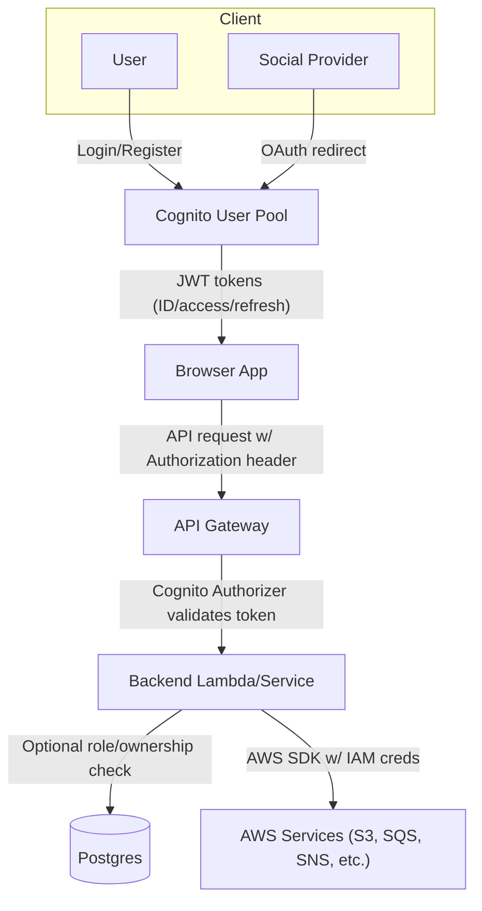
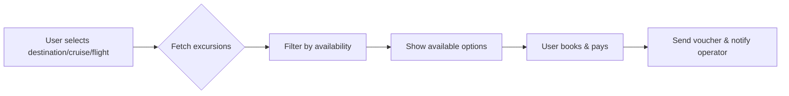
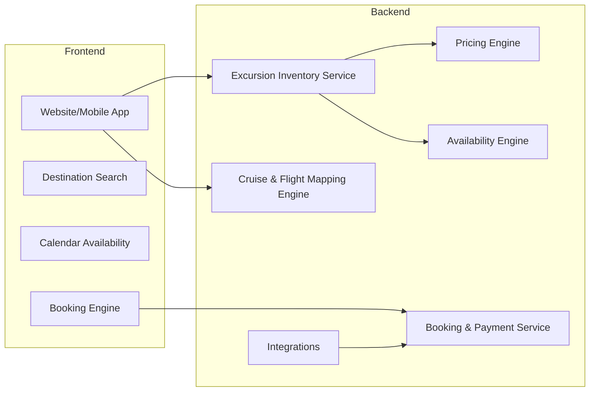
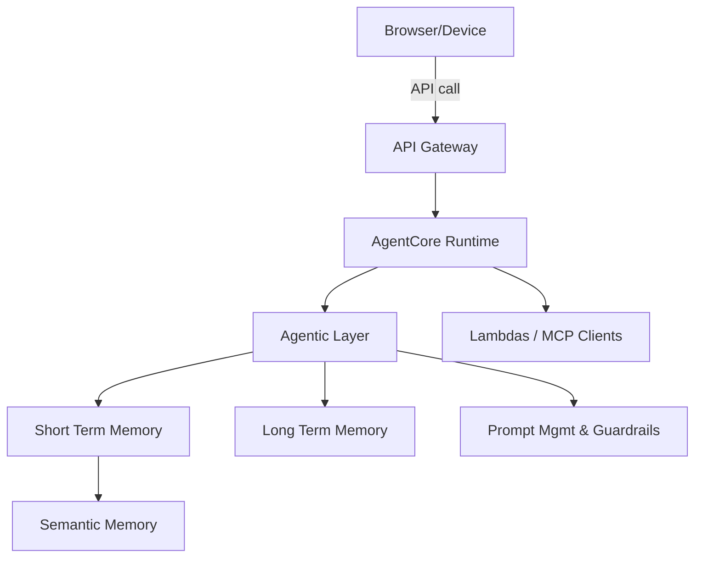
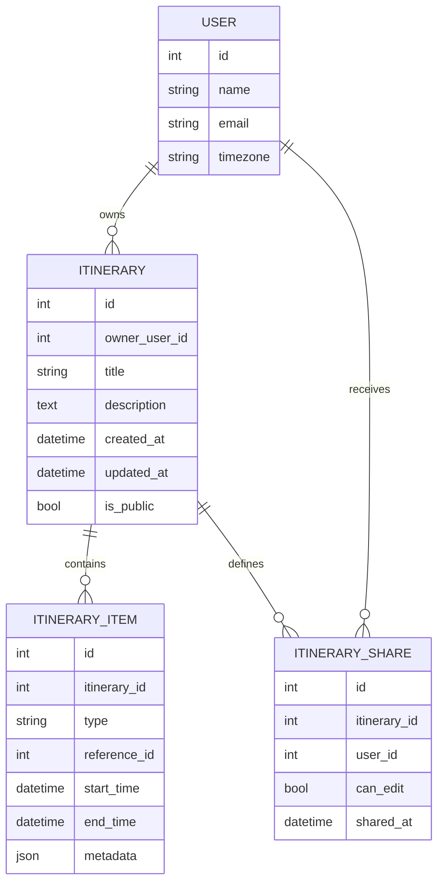
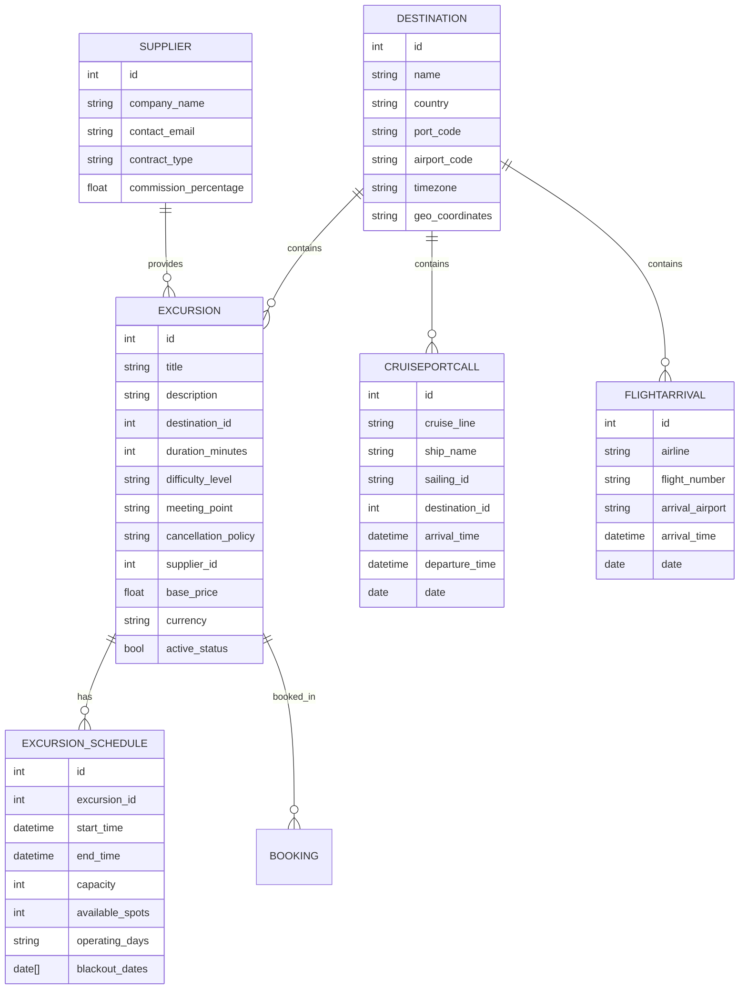

# Excursion Design

## Project Specification & Plan

### Objective
- Build a web app for assembling itineraries composed of shore excursions, hotel bookings, leisure time, coffee shops, flight bookings, and cruise bookings.  The design here focuses on the **shore excursion** component as part of that broader plan.

### Tech Stack (AWS-centric)
- **Frontend:** React 18+, TypeScript, Vite, Tailwind CSS
- **Backend & AI:** Go services and AgentCore runtime deployed behind **AWS API Gateway** with Lambda functions for orchestration.
- **AI Layer:** AWS Bedrock (AgentCore) plus supporting Lambdas, short/long term memory stores (DynamoDB or S3) and SQS for asynchronous processing.
- **Database:** PostgreSQL (Amazon RDS or Aurora)
- **Storage:** S3 for assets, conversation logs, and memory snapshots.
- **Messaging:** SQS for internal task queues, SNS for event notifications, SES/SNS for email/SMS communications.
- **Authentication:** AWS Cognito for login/registration; supports passwordless flows and federated identity with Google, Microsoft, Facebook, Instagram, TikTok, LinkedIn, etc.
- **Payments:** Stripe/Adyen integrated via Lambda and API Gateway.
- **Other AWS:** CloudWatch for logging/metrics, Secrets Manager for credentials, CloudFront/CDN for frontend distribution.

### Developer Commands
- Build: `npm run build` (compiles TypeScript, outputs to dist/)
- Test: `npm test` (runs Jest, must pass before commits)
- Lint: `npm run lint --fix` (auto-fixes ESLint errors)
- Deploy commands will also provision/update AWS resources via CDK or Terraform (TBD).

### Authentication & Authorization Flow

The system uses **AWS Cognito** for all user identity management. Below is a high-level flow:



1. **User signs in** via credentials, passwordless link/OTP, or federated provider.
2. Cognito issues tokens which the client stores securely.
3. Every API call includes the access token; API Gateway ensures authenticity.
4. Backend services may enforce additional authorization rules (e.g., itinerary ownership, admin role).
5. Cognito identity pools grant temporary AWS credentials allowing direct access to other services if needed.

This centralized flow simplifies support for social logins (Google, Microsoft, Facebook, Instagram, TikTok, LinkedIn) and passwordless experiences.


### Project Structure
- `src/` - Application source code
- `tests/` - Unit and integration tests
- `docs/` - Documentation (this file is part of it)

### Development Policies
- ✅ Always run tests before commits and follow naming conventions
- ⚠️ Ask the team before making database schema changes or adding dependencies
- 🚫 Never commit secrets, edit `node_modules/`, or modify CI configuration

---


## Business Model & User Flow

**Concept:**

User chooses one of:

- A destination (e.g., Cozumel, Barcelona, Nassau)
- A cruise itinerary
- A flight arrival city

System returns:

- Relevant shore excursions
- Available time slots
- Pricing
- Capacity
- Cut-off rules

User books → pays → receives voucher → operator notified.



---

## System Architecture



### Integrations

- Cruise schedule feeds
- Flight schedule APIs
- Payment gateway (Stripe/Adyen)
- Email/SMS notifications

### Partner Excursions & MCP Configuration

- The platform will also **sell partner shore excursions** directly through our site.
- Products will be configured via MCP tools, allowing dynamic inventory and pricing updates from suppliers.
- A **payment service** is required to handle transactions for these sales, integrating with the chosen gateway (Stripe/Adyen) and recording payments against itinerary items.
- The MCP clients used elsewhere (for AI and external tool access) will likewise manage excursion inventory flows and synchronization.

---

## Data Model Design

### AI Architecture Overview

The product integrates an **agentic AI layer** to assist users during trip planning. Key components:

- **API Gateway** receives requests from the frontend and routes them to the AI stack.
- **AgentCore Runtime** (powered by AWS Bedrock in the draw.io) executes the inference pipeline.
- **Agentic Layer** manages prompts, guardrails, and user context.
- **Short-term and long-term memory stores** hold conversation state, user preferences, and summaries.
- **Lambda functions** (or similar serverless workers) orchestrate prompt management and interact with external tools via MCP clients.
- User conversation state and history feed into the memory stores; semantic memory is used for personalization and summarization.

A simplified Mermaid diagram:



The AI layer will power recommendations, conflict detection, and natural-language planning assistance.

### Itineraries & Sharing

- Primary user builds a trip plan including excursions, flights, hotels, leisure time and other bookings.
- For MVP, users **do not book through our site**; instead they import booking details via cut/copy-paste.
  - Separate import templates or text areas for each category (cruise, hotel, flight, leisure, etc.)
  - Leisure time entries are simply added as items with type `leisure` and a timeframe.
- Completed plans are persisted to the database and associated with the creating user.
- Plans may be shared with other users (friends, family) by granting view or edit permissions.
- Shared users can view the plan; editing is allowed only when the primary user explicitly grants edit rights.
- Permissions can be revoked at any time by the owner.

### SQL Schema Examples

```sql
CREATE TABLE users (
    id SERIAL PRIMARY KEY,
    name TEXT NOT NULL,
    email TEXT UNIQUE NOT NULL,
    timezone TEXT,
    created_at TIMESTAMP DEFAULT now()
);

CREATE TABLE itineraries (
    id SERIAL PRIMARY KEY,
    owner_user_id INTEGER REFERENCES users(id),
    title TEXT,
    description TEXT,
    created_at TIMESTAMP DEFAULT now(),
    updated_at TIMESTAMP DEFAULT now(),
    is_public BOOLEAN DEFAULT FALSE
);

CREATE TABLE itinerary_items (
    id SERIAL PRIMARY KEY,
    itinerary_id INTEGER REFERENCES itineraries(id),
    type TEXT CHECK (type IN ('excursion','flight','hotel','cruise','leisure','other')),
    reference_id INTEGER, -- could point to schedule or external record
    start_time TIMESTAMP,
    end_time TIMESTAMP,
    metadata JSONB
);

CREATE TABLE itinerary_shares (
    id SERIAL PRIMARY KEY,
    itinerary_id INTEGER REFERENCES itineraries(id),
    user_id INTEGER REFERENCES users(id),
    can_edit BOOLEAN DEFAULT FALSE,
    shared_at TIMESTAMP DEFAULT now()
);
```

### JSON Document Examples

```json
{
  "itinerary": {
    "id": 42,
    "owner_user_id": 3,
    "title": "Bahamas Spring Break",
    "is_public": false
  },
  "items": [
    {
      "id": 101,
      "type": "flight",
      "start_time": "2026-05-10T08:00:00Z",
      "end_time": "2026-05-10T12:00:00Z",
      "metadata": {"airline": "Delta", "flight_number": "DL123"}
    },
    {
      "id": 102,
      "type": "excursion",
      "start_time": "2026-05-10T14:00:00Z",
      "end_time": "2026-05-10T17:00:00Z",
      "metadata": {
        "title": "Snorkel Adventure",
        "supplier": {"name": "AquaTours", "contact": "info@aquatours.com"}
      }
    },
    {
      "id": 103,
      "type": "leisure",
      "start_time": "2026-05-10T17:30:00Z",
      "end_time": "2026-05-10T19:00:00Z",
      "metadata": {"description": "Beach walk"}
    }
  ],
  "shares": [
    {"user_id": 5, "can_edit": true},
    {"user_id": 9, "can_edit": false}
  ]
}
```

```json
{
  "user": {"id": 3, "name": "Alice", "email": "alice@example.com"}
}
```

### Data model additions for sharing






---

## Booking & Inventory Logic

### Excursions & Supplier Data

- Excursions are provided by third-party operators; when imported the user should capture:
  - Excursion title, description, meeting point, duration
  - Supplier/company name and contact info (email/phone/website)
  - Booking reference or link (if available)
- This supplier information becomes part of the itinerary item and can be viewed by shared members.
- When offering selections, a recommendation section should suggest top-rated or popular excursions for the chosen destination.
- Recommendations may be weighted by user preferences, past bookings, or supplier ratings.

### Conflict Detection & Red Flags

- As itinerary items are added, the system must check for:
  - Time overlaps between excursions, flights, hotels, and leisure slots
  - Excursions that start before arrival buffers or end after departure buffers
  - Supplier warnings (e.g., known cancellations, capacity issues)
- Any conflicts or red flags should be surfaced to the user immediately with guidance on resolution (e.g., "This excursion overlaps with your 2pm flight").
- The notification system can also alert when a supplier has a history of poor reviews or when bookings exceed capacity.

### Inventory Rules
When a user selects:

- Destination: Cozumel
- Date: May 10
- Cruise arrival: 8:00 AM
- Departure: 5:00 PM

System should:

1. Fetch excursions for Cozumel
2. Filter by:
   - Operating day
   - Available capacity
   - Start time ≥ arrival + buffer
   - End time ≤ departure - buffer

> **Buffer Example:**
> - Arrival buffer: 1 hour
> - Return buffer: 1.5 hours

---

## Destination-Based Selling Logic

### Scenario 1: User selects destination only

Show:

- Top-rated excursions
- Duration filters
- Price range
- Categories (Beach, Adventure, Culture, Food)

### Scenario 2: User selects cruise first

Eligible Excursion if:

```
start_time > cruise_arrival + buffer
AND
end_time < cruise_departure - buffer
```

### Scenario 3: User selects flight arrival

Eligible Excursion if:

```
start_time > flight_arrival + buffer
```

Layover:

```
end_time < next_flight_departure - buffer
```

#### Option A: Static Mapping (pre-mapping)

CruiseShip X → Allowed Excursion IDs

#### Option B: Dynamic Mapping (Better)

Calculate eligibility dynamically based on time windows.

---

## Pricing & Yield Management

- **Option 1:** Fixed Price
- **Option 2:** Tiered
  - Adult
  - Child
  - Infant
- **Option 3:** Dynamic Pricing
  - Based on demand
  - Cruise occupancy
  - Seasonality
  - Remaining capacity

---

## Admin & Operations Tools

- Supplier Dashboard
  - Add excursions
  - Manage availability
  - View bookings
  - Set blackout dates
- Operations Dashboard
  - Manifest per excursion
  - Passenger list
  - Emergency contacts
  - Live capacity tracking
  - Reporting
    - Revenue by destination
    - Revenue by cruise line
    - Commission tracking
    - Refund tracking

### A. Category System
- Adventure
- Cultural
- Water Sports
- VIP

### B. Reviews & Ratings

### C. Cross-Sell
If user books:
- Snorkeling

Offer:
- Beach club add-on

---

## Critical Operational Safeguards

- Always build time-zone-aware logic
