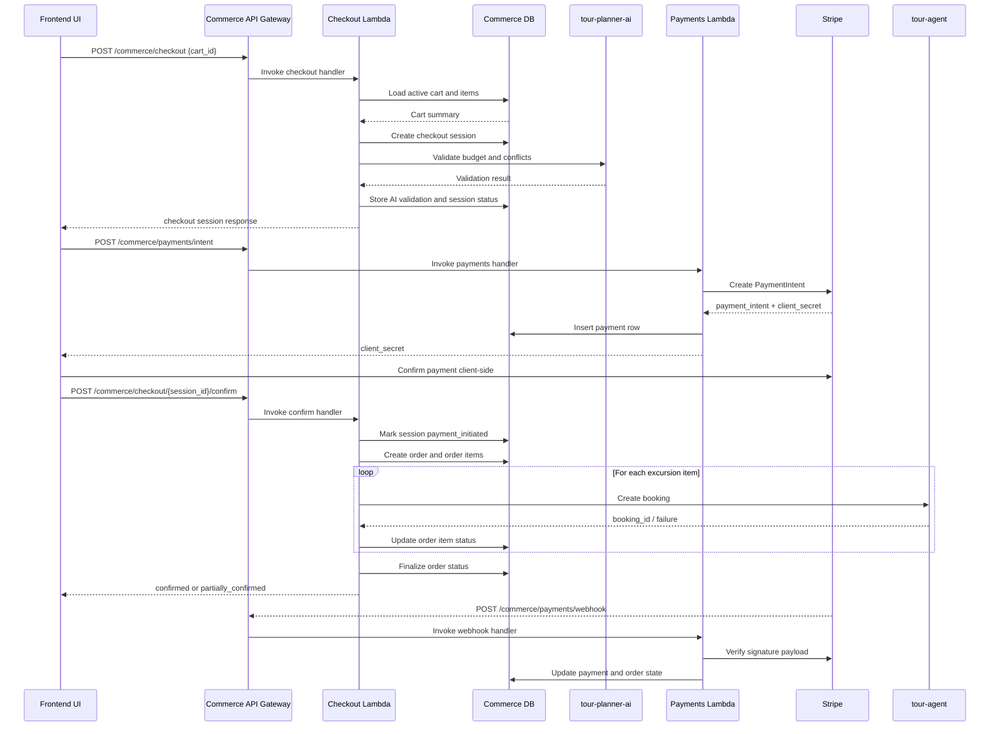

# Tour Commerce Architecture

## Overview

`tour-commerce` is the commerce subsystem for the tour-planner platform. It owns the cart, checkout, order, payment, and AI-assisted commerce flows that sit between the consumer UI and the transactional systems that actually confirm bookings.

The repo is organized around two concerns:

- Go Lambda services under `services/` implement the commerce domain APIs.
- AWS CDK code under `infrastructure/` provisions the isolated commerce database, API Gateway, Lambda functions, and event fabric.

Commerce is intentionally separated from `tour-agent`:

- `tour-agent` remains the system of record for trip plans, excursion inventory, and final booking creation.
- `tour-commerce` owns the purchase workflow and its own database.
- `tour-planner-ai` provides recommendation, budget-check, and upsell intelligence, but does not own transactional state.

## System Context

At a high level, the runtime path is:

1. The frontend calls the `tour-commerce` API for cart, checkout, order, payment, and AI endpoints.
2. Commerce Lambdas persist workflow state in the commerce Aurora PostgreSQL cluster.
3. Checkout and AI endpoints call `tour-planner-ai` for recommendation, budget, conflict, and upsell logic.
4. Checkout confirms bookable excursion items by calling `tour-agent` booking APIs.
5. Payment handling uses Stripe for PaymentIntents, webhooks, and refunds.
6. Domain events are emitted and consumed through the commerce EventBridge bus.

## Repository Layout

Key directories:

- `services/cart/`: cart creation and line-item management
- `services/checkout/`: checkout orchestration and booking confirmation
- `services/orders/`: order retrieval and cancellation
- `services/payments/`: Stripe PaymentIntent, webhook, and refund handling
- `services/ai-commerce/`: AI recommendation, budget-check, and upsell bridge
- `infrastructure/bin/app.ts`: CDK app entrypoint
- `infrastructure/lib/stacks/`: database, API, and events stacks
- `infrastructure/database/migrations/`: schema definition for the commerce database

## Runtime Components

### API Layer

The API surface is provisioned by `CommerceApiStack` and exposed through a single API Gateway REST API named `tour-commerce-api`.

Authentication model:

- Most routes use a Cognito User Pool authorizer shared with `tour-agent`.
- The Stripe webhook route is intentionally unauthenticated at API Gateway and verifies the Stripe signature inside the Lambda.

Primary route groups:

- `/commerce/cart`
- `/commerce/checkout`
- `/commerce/orders`
- `/commerce/payments`
- `/commerce/ai`

### Cart Service

The cart Lambda manages shopping cart state.

Responsibilities:

- create a cart for a user
- fetch the active cart or a cart by ID
- add, update, and remove cart items
- enforce ownership and active-cart semantics

The cart service persists item snapshots at add time so later catalog changes do not mutate existing carts.

### Checkout Service

The checkout Lambda is the main workflow coordinator.

Responsibilities:

- create checkout sessions from active carts
- call `tour-planner-ai` for budget validation and conflict detection
- persist the AI validation snapshot on the checkout session
- create an order once payment is ready
- call `tour-agent` to create bookings for excursion items
- transition session and order states based on booking outcomes

Important behavior:

- checkout is a two-step flow: initiate session, then confirm
- AI validation happens before confirmation
- excursion bookings are confirmed item-by-item, allowing partial confirmation

### Orders Service

The orders Lambda exposes order lifecycle reads and cancellation.

Responsibilities:

- list a user’s orders with paging
- fetch order details by ID
- cancel eligible orders

This service is the consumer-facing read and control layer for completed checkout flows.

### Payments Service

The payments Lambda integrates with Stripe.

Responsibilities:

- create Stripe PaymentIntents for orders
- record payment rows in the commerce database
- process Stripe webhooks for succeeded, failed, and refunded payments
- update order and payment status based on webhook events
- trigger refunds against Stripe PaymentIntents

Key integrations:

- `STRIPE_SECRET_KEY`
- `STRIPE_WEBHOOK_SECRET`

### AI Commerce Service

The AI commerce Lambda is a thin bridge between commerce and `tour-planner-ai`.

Responsibilities:

- recommendation requests for cart-building flows
- budget-check requests for spending validation
- upsell requests for complementary offers
- audit logging of AI interactions when the database is available

This service does not own recommendation models itself. It forwards requests to `tour-planner-ai` and records interaction metadata in the commerce database.

## Data Architecture

`tour-commerce` has its own Aurora Serverless v2 PostgreSQL cluster. This isolates commerce workflow state from the `tour-agent` transactional database while still allowing cross-service references by ID.

The initial schema is defined in `infrastructure/database/migrations/V001__commerce_schema.sql`.

### Core Tables

#### Cart Domain

- `commerce_carts`: one active cart per user workflow, optionally linked to a `tour-agent` trip plan
- `commerce_cart_items`: line items across excursions, hotels, flights, restaurants, cruises, and packages

Key characteristics:

- item snapshots are frozen at add time
- AI recommendation metadata can be attached to items
- items can carry a `traveler_date` for schedule-aware workflows

#### Checkout Domain

- `commerce_checkout_sessions`: short-lived sessions that capture billing details, total amount, expiry, and AI validation

This table stores the budget/conflict validation snapshot returned by `tour-planner-ai` so the approval decision used for payment remains auditable.

#### Order Domain

- `commerce_orders`: purchase-level state for confirmed or failed checkout attempts
- `commerce_order_items`: item-level booking outcomes within an order

Important detail:

- `tour_agent_booking_id` on `commerce_order_items` stores the booking identifier returned by `tour-agent` after successful booking creation

#### Payment Domain

- `commerce_payments`: Stripe or other provider payment records, including refund state and failure details

#### AI Audit Domain

- `commerce_ai_interactions`: audit log of recommendation, budget-check, upsell, and related AI calls made during commerce flows

### Cross-Service Data References

The schema uses logical cross-service references rather than enforced foreign keys across databases.

Examples:

- `trip_plan_id` references `tour-agent` trip state
- `tour_agent_booking_id` references bookings created by `tour-agent`
- cart and checkout payloads may embed supplier or catalog item identifiers maintained elsewhere

## Infrastructure Architecture

The CDK app provisions three stacks.

### CommerceDatabaseStack

Responsibilities:

- create a dedicated Aurora Serverless v2 PostgreSQL cluster
- create a Secrets Manager secret for DB credentials
- run schema migrations through a migration Lambda and custom resource trigger

Important design points:

- commerce uses the shared VPC from `tour-agent`
- the database remains isolated even though networking is shared
- migrations are run automatically during deployment

### CommerceApiStack

Responsibilities:

- create the five commerce Lambda functions
- create the REST API Gateway
- wire shared environment variables and secret access
- reuse the existing Cognito user pool from `tour-agent`

Common Lambda configuration:

- runtime: `PROVIDED_AL2023`
- private subnets in the shared VPC
- 30-second timeout
- 256 MB memory
- two-week log retention

Shared environment variables include:

- `DB_SECRET_ARN`
- `DB_ENDPOINT`
- `DB_NAME`
- `TOUR_AGENT_API_URL`
- `TOUR_PLANNER_AI_URL`

### CommerceEventsStack

Responsibilities:

- create an EventBridge bus named `tour-commerce`
- route booking and payment domain events to Lambda targets
- create a dead-letter queue for failed event delivery
- create an SNS topic for order notifications

Current event rules:

- `tour-agent.bookings` + `BookingConfirmed` routes to the orders Lambda
- `tour-commerce.payments` + `PaymentSucceeded` routes to the payments Lambda for post-purchase AI upsell handling

## Sequence Diagram

The most important runtime path is the checkout-to-booking flow, where commerce coordinates payment readiness, AI validation, and final booking confirmation.

## End-to-End Flow

This is the end-to-end commerce flow in operational order.

### 1. Cart Assembly

1. The user creates a cart or reuses an active cart.
2. The cart service stores selected items in `commerce_cart_items`.
3. Each item carries a frozen price and metadata snapshot so the cart remains stable even if the upstream catalog changes.

### 2. Checkout Session Initialization

1. The client starts checkout with `POST /commerce/checkout`.
2. The checkout service loads the cart, validates ownership, and rejects empty or inactive carts.
3. A checkout session is created in `commerce_checkout_sessions`.
4. The checkout service calls `tour-planner-ai` for budget and conflict validation.
5. The AI result is written back to the checkout session and logged in `commerce_ai_interactions`.

### 3. Payment Intent Creation

1. The client calls `POST /commerce/payments/intent` for the order amount.
2. The payments service creates a Stripe PaymentIntent.
3. The service stores a corresponding row in `commerce_payments`.
4. The client receives the Stripe `client_secret` and completes payment collection.

### 4. Order Confirmation

1. After payment initiation, the client calls `POST /commerce/checkout/{session_id}/confirm`.
2. The checkout service creates the order shell in `commerce_orders`.
3. The checkout service iterates over excursion items and calls `tour-agent` to create real bookings.
4. Each successful booking updates the corresponding `commerce_order_items` row with `tour_agent_booking_id`.
5. The order is finalized as `confirmed` or `partially_confirmed` depending on item-level outcomes.

### 5. Payment State Reconciliation

1. Stripe sends webhook events to `/commerce/payments/webhook`.
2. The payments service verifies the webhook signature.
3. Payment rows are updated to `succeeded`, `failed`, or refunded states.
4. Related order state is reconciled based on the payment outcome.

### 6. Post-Purchase AI and Eventing

1. Payment and booking events can be emitted onto the `tour-commerce` EventBridge bus.
2. The events stack routes selected events to payments or orders handlers.
3. Follow-on upsell or notification flows can be layered on top of those events without changing the synchronous checkout path.

## Key Request Flows

### 1. Cart Build Flow

1. User creates or fetches an active cart.
2. User adds one or more items to the cart.
3. Cart items store a frozen snapshot of price and item metadata.

### 2. Checkout Validation Flow

1. Client posts `cart_id` to `/commerce/checkout`.
2. Commerce loads the cart and rejects inactive or empty carts.
3. Checkout creates a checkout session row.
4. Commerce calls `tour-planner-ai` for budget/conflict validation.
5. The AI response is logged in `commerce_ai_interactions`.
6. The checkout session is marked `ai_validated` or `failed` based on the AI result.

### 3. Payment and Booking Confirmation Flow

1. Client creates a PaymentIntent through `/commerce/payments/intent`.
2. Client confirms checkout through `/commerce/checkout/{session_id}/confirm`.
3. Commerce creates an order row.
4. For each excursion item, commerce calls `tour-agent` to create a booking.
5. Each successful booking updates the corresponding order item with `tour_agent_booking_id`.
6. The order becomes `confirmed` or `partially_confirmed` depending on item-level results.

### 4. Stripe Webhook Flow

1. Stripe sends a webhook to `/commerce/payments/webhook`.
2. Commerce verifies the webhook signature.
3. Payment status is updated in `commerce_payments`.
4. Related order state is updated to `confirmed`, `failed`, or refunded state.

### 5. AI Recommendation and Upsell Flow

1. Client calls an AI endpoint under `/commerce/ai`.
2. Commerce forwards the request to `tour-planner-ai`.
3. The response is returned to the caller.
4. Interaction metadata is written to `commerce_ai_interactions` when DB logging is available.

## Security and Trust Boundaries

Key boundaries in the current design:

- API access is protected by Cognito except for Stripe webhooks
- Stripe webhooks rely on signature verification instead of JWT auth
- Lambdas read DB credentials from Secrets Manager rather than embedding connection strings
- Commerce runs in private subnets inside the shared VPC
- Commerce owns its own database so order and payment state are not mixed into `tour-agent`

## Operational Notes

Build and deploy entrypoints:

- root service build: `npm run build` from `tour-commerce/`
- CDK synth: `npm run infra:synth` from `tour-commerce/`
- CDK deploy: `npm run infra:deploy` from `tour-commerce/`

Service packaging:

- each Go service is bundled from its `handler` package into a Lambda `bootstrap` binary

Deployment prerequisites:

- shared VPC and security group IDs from `tour-agent`
- Cognito user pool ARN from `tour-agent`
- `TOUR_AGENT_API_URL`
- `TOUR_PLANNER_AI_URL`
- Stripe secrets in Secrets Manager

## Design Summary

`tour-commerce` is a workflow-owned commerce layer rather than a catalog system. Its primary job is to:

- assemble purchasable items into carts
- validate commerce decisions with AI
- collect payment through Stripe
- convert qualifying items into real bookings in `tour-agent`
- retain independent auditability for orders, payments, and AI-assisted decisions

That split keeps booking authority in `tour-agent`, recommendation logic in `tour-planner-ai`, and purchase orchestration in `tour-commerce`.